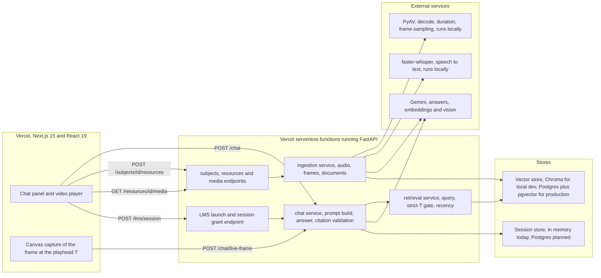
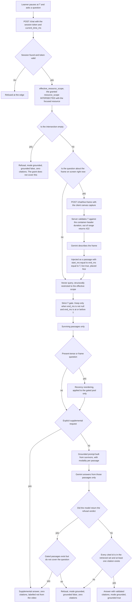
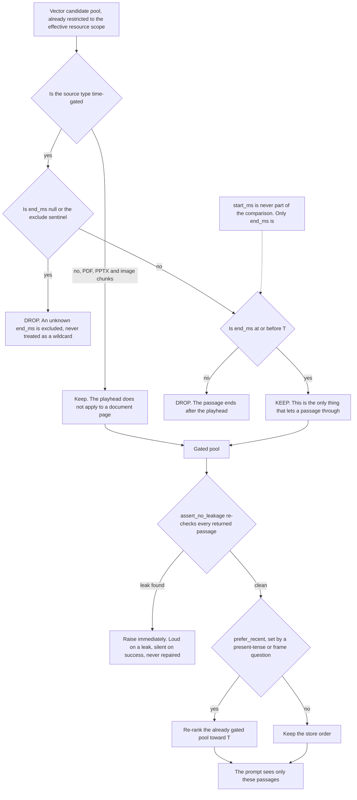
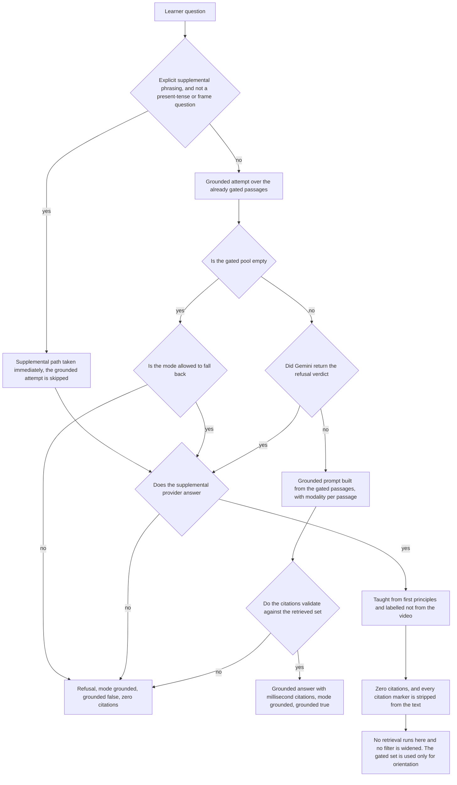
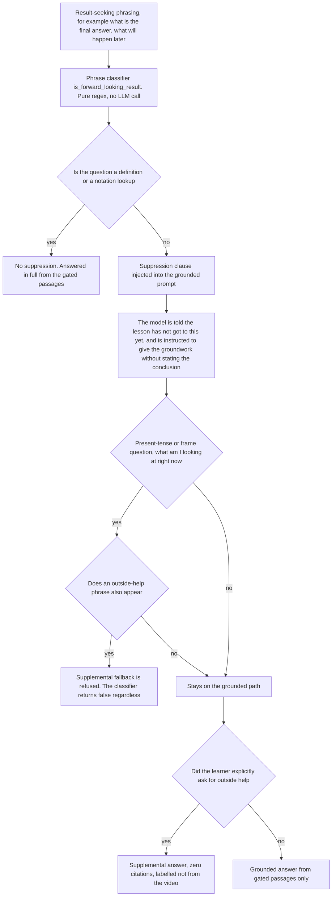

# PPT_CONTENT.md: Malai Pioneer, hackathon deck

Paste-ready slide content mapped 1:1 onto the official 6-slide template.

**Rules honoured while writing this file**

- Every technical claim traces to `PROJECT.md` or `claims.md`. Nothing invented.
- `[SHIPPED]` and `[PLANNED]` tags are carried onto the slides. A plan never appears as a shipped claim.
- No market sizing, no TAM, no growth rates, no survey figures, no team names.
- Mermaid labels avoid `<`, `>`, parentheses, colons and the reserved word `end`.
- The batched-embedding item is presented as delivered per team decision, with no speedup percentage, because no speedup was ever measured.

---

## COVER

**Project title:** Malai Pioneer

**Tagline:** A lecture-aware AI tutor that answers only from what you have already watched, and cites the exact millisecond it is talking about.

| Cover field | Value |
|---|---|
| PRESENTED BY | [FILL IN: Team member names] |
| CO-PRESENTED BY | [FILL IN: Co-presenter names, if any] |
| POWERED BY | Google Gemini for generation, embeddings and vision. faster-whisper for speech to text. PyAV for decode. LangChain splitters. |
| CO-POWERED BY | Next.js 15, React 19, Tailwind v3, FastAPI, Chroma, Vercel, KaTeX |

---

## SLIDE 1 / 6 — Problem Statement & Proposed Solution

### A. Problem understanding

- A learner is six minutes into an eleven-minute lecture. They do not understand a line on the board and they want an answer now, not a search box and not a later timestamp.
- General-purpose LLM assistants will answer that question, and they will answer it using the part of the lecture the learner has not reached yet. The answer may be correct and still be a spoiler.
- Video platforms give captions and a scrubber. Captions are a transcript with no question interface and no notion of what the learner has actually seen.
- Notes are the other fallback. Reading them is slower than asking, and notes are not bounded by the learner's current position in the lecture.
- The gap: there is no tool where "answer me, but only from what has played so far" is a property the system can prove rather than a promise in a prompt.

### B. Proposed solution

- **What is built:** a browser lecture player with an AI tutor attached at the playhead. The learner pauses, asks, and gets an answer built only from passages that end at or before the current timestamp.
- **How it solves it:** a strict timestamp gate lives in the retrieval layer, not in a prompt. A passage survives only when its end time is at or before T. A null end time is an exclude sentinel, never a wildcard. Recency reordering runs strictly downstream of the gate, so it can only reorder survivors.
- **Who uses it:** a student working through lecture material at their own pace, pausing at the point of confusion. Not a revision tool. Not a search tool.
- **What the core system is:** time-bounded embedding chunks over two modalities, transcript segments and described frames, each carrying a millisecond range and a provenance tag of `transcript` or `visual`.
- **Value proposition:** every answer either carries a citation you can seek to, or it is a refusal. The value is not a better answer, it is an auditable one.

**Flow line to print on the slide**

`Problem: an answer that spoils the lecture` → `Solution: a retrieval gate on end_ms that runs before any model call` → `User: a student paused mid-lecture` → `Outcome: a cited answer, or an honest "not yet"`

**Speaker notes:** Lead with the refusal at T equals 2 seconds. At two seconds nothing has been said and the system says so. That single row is the whole product.

---

## SLIDE 2 / 6 — Technical Architecture & System Design

**The most important slide.** Show the diagram, then walk it left to right.

### Architecture diagram

**One-line reading of the diagram:** one backend owns every policy decision. The browser only plays media, captures a canvas frame, and posts. Gemini is used for answers, embeddings and vision. The gate lives in the retrieval layer.

### TECHNICAL STACK

| Layer | Technology | Status |
|---|---|---|
| Frontend | Next.js 15, React 19, Tailwind v3, react-markdown with remark-math and rehype-katex, KaTeX with trust disabled and no rehype-raw. Hosted on Vercel. | `[SHIPPED]`, types clean and build passing |
| Backend | Python FastAPI. Runs locally in development and targets Vercel serverless functions for deployment, with long ingest work moved off the request path into background jobs. | `[SHIPPED]` as the API, Vercel function packaging `[PLANNED]` |
| Database | Chroma as the embedded local-development vector store, replaced in production by Postgres plus pgvector on a Vercel marketplace provider such as Neon, behind a VectorStore interface. Sessions are in memory today. | Chroma `[SHIPPED]`, Postgres plus pgvector `[PLANNED]` |
| AI/ML | Gemini flash for answers, Gemini embeddings, Gemini vision for frame and image description, faster-whisper for speech to text, PyAV for decode and sampling. | `[SHIPPED]` |
| Infrastructure | Vercel for the frontend and the serverless API. Neon Postgres plus pgvector for production persistence. One shared bounded-retry module for all Gemini calls. Keys live in environment variables and are never committed. | `[SHIPPED]` for deployment and retry discipline, hosted Postgres `[PLANNED]` |

### Integration posture

- Built as a **sidecar service**, not a plugin inside an LMS process. The LMS integrates with us across one defined boundary contract.
- The boundary supplies `learner_id`, `course_id`, `resource_id`, `lesson_id`, `permissions` / `resource_scope` and `current_time_ms`. Identity is established at session start and carried server-side or in a signed token. We never trust client-supplied role claims.
- Permissions are resolved server-side from the granted scope, never by the LLM. The requested focus resource is **intersected** with the granted scope, never replaced. An empty intersection returns `scope_empty`, which separates "your grant does not cover this" from "you have not watched enough".
- Unsigned launch and the dev secret are localhost-demo settings only. Production requires real HMAC-signed launches, and that enforcement is `[PLANNED]`, stated as a hard boundary rather than a backlog nicety.

**Speaker notes:** If a judge asks why not a hosted RAG platform with built-in video handling, the answer is that it would not expose a gate we control, and product policy we cannot edit is not a policy.

---

## SLIDE 3 / 6 — System Workflow & Implementation

### End-to-end workflow diagram

### IMPLEMENTATION DETAILS

**1. Core modules**
Ingestion: audio, visual frames, documents, image handling, embedding, shared backoff, purge. Retrieval: query, the strict-T gate, recency reordering, leakage assertion. Chat: prompt build, model call, citation validation, refusal and supplemental handling. LMS boundary: launch and session grant. Subjects: resources and media. Web: chat panel, markdown and LaTeX body, session provider.

**2. Important APIs**

| Endpoint | Purpose |
|---|---|
| `POST /chat` | Ask with the session token and `current_time_ms`. Returns mode, grounded flag and citations. |
| `POST /chat/live-frame` | Ask about the exact frame at the playhead, with the canvas capture. `422` if T is out of range, never clamped. |
| `GET /sessions/{session_id}/messages` | Read the transcript so far. |
| `POST /lms/session` | LMS launch boundary. Establishes identity and mints or re-mints the resource grant. |
| `POST /courses/{course_id}/ingest` | Ingest video, PDF, PPTX or image. Returns a job. |
| `GET /ingestion/jobs/{job_id}` | Job status plus the `VisualPassReport`. |
| `POST /subjects/{subject_id}/resources` | Direct upload into a subject. |
| `GET /resources/{resource_id}/media` | Streams media for the player. |
| `POST /courses/{course_id}/ingest-youtube` | `[PLANNED]` / unverified. Captions and download are unavailable in this environment. |

**3. Data flow**
Upload to the ingest endpoint. PyAV reads the real duration from the container header. Audio track to faster-whisper, so transcript timestamps come from the audio signal itself. Frames sampled at a fixed stride, described by Gemini vision, with frame timestamps taken from frame-index arithmetic. LangChain text splitters bound transcript chunks; frame descriptions are instants and are not split. One vector per chunk, modality recorded per chunk. A `VisualPassReport` records complete, partial, failed or skipped with a coverage percentage and warnings.

**4. AI/ML pipeline**
Three rejection guards make the index trustworthy before retrieval ever runs. An audio timeline that overshoots the true duration is rejected outright and the whisper result is kept. A frame index that is not one of the sampler's real indices is dropped and recorded, never clamped or reassigned. Character-proportion time-splitting was removed because splitting an instant by character share produced a 135 millisecond citation cut mid-sentence.

**5. Model interaction**
The prompt is built from gated survivors only, with modality stated per passage. The model returns an answer plus citation ids. Every returned id is checked against the retrieved set, and at least one citation must exist. An uncited answer or an unknown id is refused. A citation-validation failure is a grounding defect and never escalates to a supplemental answer, because that would launder a broken answer into a plausible one.

**6. Backend processing**
Order of operations is fixed and testable: scope intersection, vector query, strict-T gate, recency reorder on survivors only, prompt from survivors, model call, citation validation. `assert_no_leakage` re-checks every returned passage and raises immediately on a leak. Loud on failure, silent on success, never repaired.

**7. Database interaction**
Documents and images are intentionally not time-gated, because null `end_ms` is the exclude sentinel and gating a static page would make it permanently invisible. Image citations carry an image number rather than a timestamp. This is an honest asymmetry: "only what has played" is a video property, not a source-agnostic one.

**8. Authentication**
`[PLANNED]` In production, identity is the LMS's responsibility. The LMS launches the session and our service never authenticates the learner itself. For the prototype, Firebase Authentication is the planned mechanism, and HMAC-signed launch is the required production path. What is shipped today is the grant model, not the identity provider: scope intersection, `scope_empty`, and session-grant re-minting when the granted material changes.

**9. External integrations**
Gemini for answers, embeddings and frame description. faster-whisper and PyAV run locally. Live frames are cached per resource and second, so re-asking about the same moment does not re-hit the model. Describe passes are paced under the vision rate limit. Free-tier 429s are treated as expected: wait about 90 seconds, retry once, never retry-loop.

**10. Automation logic**
Ingest is a background job with a status endpoint, so a long ingest never blocks the request path. Batched embedding calls the embedding endpoint with an array of sub-requests instead of one request per chunk, and verifies the returned vector count equals the input chunk count before indexing, raising rather than indexing on mismatch, because every downstream consumer zips vectors to chunks positionally. Phrase classifiers for forward-looking and frame questions are pure regex, with no model call.

**Speaker notes:** The gate sits before reordering, before the supplemental decision and before any model call. Two exits only: a grounded answer with validated millisecond citations, or a refusal.

---

## SLIDE 4 / 6 — AI/ML Implementation & Innovation

### AI/ML component breakdown

| Question | Answer |
|---|---|
| **Where is AI/ML used** | Three places: speech to text at ingest, vision description of sampled frames and live captures at ingest, and answer generation at query time. Embeddings are the fourth, they make the index addressable. |
| **Why is it required** | The model's own knowledge cannot answer "what was on the board at six minutes". Only content extracted from the specific lecture can, and only content whose timestamp the system can prove. |
| **Model and algorithm approach** | Gemini flash for grounded generation under a constrained prompt. Gemini embeddings over time-bounded chunks. Gemini vision for frame description. faster-whisper for ASR. Chroma or pgvector for nearest-neighbour retrieval, then a deterministic hard filter. Recency as a deterministic re-rank of the gated pool. |
| **Input data and processing** | Audio track, fixed-stride sampled frames, PDFs, PPTX and images. Timestamps are taken only from the audio signal or from frame-index arithmetic. The model describes; it never places anything in time. |
| **Output and how produced** | An answer string plus citation ids with `start_ms`, `end_ms`, `modality` and `live` flags, or a refusal with `grounded: false` and zero citations, or a supplemental answer that is explicitly labelled not-from-video with every citation marker stripped. |
| **Evaluation and validation** | 299 backend tests passing with ruff clean, frontend types clean, build passing, contract check passing with 77 assertions. Six recorded live probes on the demo video. Refusals verified at T equals 2 000 ms and T equals 600 000 ms. A live frame answered with a citation of exactly 480 000 ms. Visual coverage reported as 100 percent from 164 sampled frames across 655.5 seconds. |
| **Integration with the product** | The chat panel renders citations as seekable millisecond ranges and renders LaTeX through KaTeX. Model HTML stays inert because there is no `rehype-raw` import anywhere in the app, components or lib tree. |

### The RAG pipeline, stated specifically

- **Knowledge source:** the learner's own lecture material, ingested into time-bounded chunks across two modalities.
- **Retrieval:** semantic nearest-neighbour search restricted by scope, then a hard timestamp filter. The hard filter is the product; the search is a library.
- **Context generation:** a prompt assembled from gated survivors only, with modality declared per passage, plus a suppression clause when the question is result-seeking and forward-looking.
- **Prompting:** system instructions fix the teaching-assistant register and require citation ids from the supplied set only. Grounded and supplemental prompts are separate, so a supplemental answer can never inherit a citation.
- **Safety:** citation ids validated against the retrieved set, leakage assertion after the fact, LaTeX rendering with raw HTML disabled, secrets in environment variables only.

### Grounded versus supplemental

### Recorded live probe evidence

Demo resource duration 655.5 s. These are recorded probe results, not aspirations. Every citation satisfies the end-before-T condition. No gate breaches observed.

| T in ms | Question | Result | Cited in ms | Modality |
|---|---|---|---|---|
| 2 000 | What is written on the board? | **REFUSED**, strict-T correct | none | none |
| 30 000 | What equation is on screen? | answered | 28 000 | visual |
| 600 000 | What colour is the curve? | **REFUSED**, the curve is early, honest | none | none |
| 300 000 | What is a partial derivative? | answered | 23 000 and 284 010 | transcript |
| 480 000 | Live frame capture | answered, `live: true` | 480 000 | visual |
| 30 000 | Explain eigenvalues | **REFUSED**, the known weakness being fixed | none | none |

Read the refusals first. A refusal cannot be wrong in the direction that matters, and the last row is the honest cost of the same mechanism. We would rather show you that row than hide it.

### Anti-spoiler suppression, and where we deliberately refuse to suppress

The gate removes future passages, so the only spoiler risk left is the model inferring a conclusion from earlier material. That is prompt-level mitigation, deliberately narrow, because a learner asking what a partial derivative is at 0:30 must be answered rather than refused. It is mitigation, not proof.

### Technical differentiation

- **Innovation:** the no-spoiler rule is structural, not prompt-level. A prompt cannot be a boundary, because the model would still see the future text. The gate removes it before any model call exists.
- **Better automation than existing tools:** a video platform gives you captions and a scrubber. This gives you a question interface whose answer is bounded by your own position in the lecture, with a refusal path instead of a guess.
- **Better accuracy than a plain LLM:** not a better answer, a checkable one. Every claim resolves to a millisecond range and a modality, and an uncited or unknown-id answer is refused rather than displayed.
- **Scalability of the idea:** the gate is one deterministic predicate over indexed metadata, not a learned component. It costs nothing per query and it is unit-testable, which is why it survives being re-implemented on a different vector backend.
- **UX:** citations are seekable. Clicking one takes the learner to the moment the answer came from, so a learner can check the tutor instead of trusting it.
- **Integration:** one boundary contract to an LMS, plug-in shaped, with permissions resolved server-side from the granted scope and never inferred by the model.
- **Honest limit on all of the above:** we verify provenance, that a cited passage genuinely existed and genuinely ended before T. We do not measure answer correctness or entailment.

---

## SLIDE 5 / 6 — Feasibility, Market Potential & Scalability

### A. Technical feasibility

- **Can it be built:** it is built and running. Two videos have completed the full ingest, index and answer cycle, and six live probes are recorded against one of them. We are not describing a design, we are describing a demo.
- **Required technologies:** all of them are existing libraries. faster-whisper, Gemini, LangChain splitters, Chroma, pypdf, python-pptx, PyAV. Two things were deliberately kept in house: the strict-T gate and citation validation, because no framework exposes a gate we control.
- **API and data availability:** Gemini's documented free-tier limits shape the design rather than block it. Embedding requests are paced against the 100 per minute floor, describe passes against the 15 per minute vision limit, and 429s are an expected path with one bounded retry. Keys come from environment variables and are never committed.
- **Infrastructure requirements:** a frontend host, a serverless or container host for the API, one vector store, and one external model provider. Ingest runs as a background job so a multi-minute video never blocks a learner.
- **Development complexity:** the hard parts are not model calls, they are the three indexer guards, the two-exit answer contract and the browser-side canvas capture. Cross-origin media is a silent-failure trap: without `crossOrigin="anonymous"` the capture fails while every test still passes.
- **Deployment approach:** the whole app targets Vercel. Frontend as a Vercel project, FastAPI as Vercel serverless functions, Postgres plus pgvector via a Vercel marketplace provider such as Neon for production persistence, Chroma retained as the embedded local-development store. Static session persistence is `[PLANNED]`.
- **Limitations stated up front:** two eleven-minute videos end to end, one subject. No long-form test, no multi-page document at scale, no load test, no baseline comparison against plain RAG. Sessions are in memory, so a restart loses them. YouTube ingest is unverified because captions and download are unavailable in this environment. Ingest of a seven-minute video took over seven minutes, dominated by embedding.

### B. Market and user feasibility

*No market sizing is claimed. No TAM, no growth rate, no survey. The argument is that the alternatives fail a specific person at a specific moment.*

- **Target users:** a student working through lecture material at their own pace, who pauses at the point of confusion and needs an answer constrained to their current position. Secondarily, an instructor who wants students to be able to interrogate a recording without being handed the ending.
- **Alternative 1, video platforms and lecture portals.** They ship captions and a scrubber. Captions are a transcript with no question interface, and nothing in the player knows which parts the learner has actually seen. The learner still has to read ahead to find the line they missed, which is exactly the context switch they were trying to avoid.
- **Alternative 2, general-purpose LLM chat assistants.** They are the serious competitor, and they fail precisely here. Given a whole lecture, they will use the part of the learner has not reached. We verified the same failure mode from the other side: "what will the final answer be" and "what happens later" are answerable by a model that has the full transcript, and those answers are spoilers by definition.
- **Alternative 3, re-reading notes.** Slower than asking, and not bounded by position. We would still claim notes are better for revision *after* the lecture, and we do not claim otherwise. This is a mid-lecture tool, not a revision tool.
- **Why users adopt it:** the answer is auditable in one click. A learner who is suspicious of an AI answer can seek to the cited millisecond and check it against the video. That is the adoption argument, and it does not depend on the answer sounding better than a chatbot's.
- **Business and application use:** modular by design, so the same retrieval core sits behind an LMS sidecar rather than requiring the LMS to be rebuilt. One boundary contract, permissions supplied by the host, LTI and xAPI style integration as the target shape. In production the LMS owns authentication and we never see a raw password.

### C. Scalability

- **Users:** the API layer is designed stateless so any replica can serve any request, which is what makes horizontal scale-out possible on Vercel. Today sessions live in a single in-memory store, so we cannot yet claim concurrent multi-user behaviour. Postgres plus pgvector is the fix and is `[PLANNED]`.
- **Database:** sessions and vectors move to Postgres plus pgvector so both outlive a restart. The `VectorStore` interface is the migration seam: swap pgvector for a dedicated vector backend behind the same contract without touching the gate.
- **API:** serverless scaling on Vercel, with ingest moved to background jobs so a long ingestion never occupies a request worker and concurrent learners are never blocked by an upload.
- **Cloud deployment:** Vercel for the frontend and functions, Neon Postgres plus pgvector for data, Gemini for models. No self-managed GPU, no always-on vector cluster. The scaling boundary is explicitly the Postgres instance, with trigger points defined for moving the vector backend.
- **AI/ML scaling:** the gate and the leakage assertion are local and deterministic, so they add no model calls. Live frames are cached per resource and second so repeated questions about the same moment do not re-hit the model. The cost driver is ingest-side embedding, not query.
- **Future expansion:** multi-subject and long-form coverage matrix, delete-resource endpoint with subject detach, HMAC-signed launch enforcement, YouTube ingest verification, and a dedicated vector backend once measured p95 justifies it.

---

## SLIDE 6 / 6 — Development Roadmap, Expected Impact & Team

### Development roadmap

| Phase | What was done | Status |
|---|---|---|
| **1. Problem understanding** | Identified that the real constraint is provable time-bounded grounding, not chat quality. Rejected prompt-level filtering, a hosted RAG platform, and long-context-over-video. | Done |
| **2. Architecture and development** | One FastAPI process owning every policy decision. Multi-modal ingest across video, PDF, PPTX and image. Scope intersection and grant model. Chroma store. | Done |
| **3. AI/ML integration** | Whisper ASR, Gemini vision, Gemini embeddings, Gemini grounded generation. Three indexer guards for timestamp authority. Strict-T gate, recency re-rank, citation validation, leakage assertion. Batched embedding call path. | Done, with Supplemental answering still landing |
| **4. Testing and validation** | 299 backend tests, ruff clean, frontend types clean, build passing, contract check with 77 assertions. Six recorded live probes, refusals verified at T equals 2 000 and 600 000, live frame cited at exactly 480 000. | Done |
| **5. Deployment** | Vercel frontend and serverless API, Neon Postgres plus pgvector, Firebase Authentication for the prototype with HMAC-signed launch required in production. | `[PLANNED]` |
| **6. Final product** | Postgres persistence, delete-resource endpoint with subject detach, HMAC launch enforcement, long-form and multi-subject coverage matrix, YouTube ingest verification. | `[PLANNED]` |

### Expected impact

- **User impact:** a learner stuck mid-lecture gets an answer in one interaction instead of a search, a scrub and a rewind. When the lecture has genuinely not got there yet, they get a clear "not yet" instead of a confident answer that spoils the rest of the session.
- **Industry impact and automation:** the pattern generalises. Any time-ordered source, lecture, lab recording, safety walkthrough or induction video, gets the same property: answer only from what has been consumed, cite the moment, refuse otherwise. The reuse is the gate plus the time-bounded index, not the chat UI.
- **Cost and time reduction:** stated qualitatively, because we have no measured cost-per-question and no measured query latency. What exists are the mechanisms: one embedding call per batch rather than per chunk, live frames cached per resource and second, describe passes paced under the vision limit, small bounded top-k. The honest current cost problem is ingest wall time, over seven minutes for a seven-minute video, whose cause is identified.
- **Accessibility:** a learner who cannot re-watch at double speed, or who is revising in a second language, gets millisecond-precise navigation into the recording. Every answer is auditable by a screen reader or by a human, which is a stronger accessibility story than a confident paragraph with no sources.
- **Long-term potential:** modular and integration-friendly by construction. The same core plugs into an LMS behind one boundary contract, with permissions resolved server-side. The LMS keeps identity, enrolment and grading; we only ever supply time-bounded, cited answers.

### TEAM

- **Team Name:** [FILL IN: Team Name]
- **Team Leader:** [FILL IN: Team Leader Name]

| Role | Name | Focus |
|---|---|---|
| Backend and AI Engineering | [FILL IN] | Retrieval service, the strict-T gate, citation validation, prompt build |
| Frontend Engineering | [FILL IN] | Chat panel, video player, live-frame canvas capture, LaTeX rendering |
| Machine Learning and Ingestion | [FILL IN] | Whisper, Gemini vision, embedding pipeline, timestamp authority guards |
| UI/UX and Design | [FILL IN] | Citation affordances, refusal copy, learner flow |

### FINAL SUBMISSION

A short reel covering the hackathon, the team and the innovation, posted to Instagram or LinkedIn.

**Reel link:** [FILL IN]

**Closing line for the slide:** Every answer either carries a millisecond you can seek to, or it is a refusal.

---

## Appendix: numbers used on these slides

Only for the speaker. If a slide number is challenged, the command wins.

| Figure | Exact meaning |
|---|---|
| 299 | pytest tests passing in `apps/api`, full run, ruff clean |
| 77 | contract-check assertions, `npm run contract-check` in `apps/web` |
| 100% | visual coverage of the demo resource, from 164 sampled frames across 655.5 s |
| 164 / 174 / 89 | sampled frames / visual chunks / transcript chunks for the demo resource |
| 263 | total indexed chunks, 89 plus 174, for the demo resource |
| 2 000 / 600 000 ms | T for the two verified strict-T refusals |
| 480 000 ms | T for the live-frame probe, cited exactly at T, single probe not a repeated measurement |
| 7 min | ingest wall time for a seven-minute video, dominated by embedding, cause identified |
| 2 | videos exercised end to end, both about eleven minutes, one subject. Volunteer this number. |
| 48% | production-gap rate under a loose gate, from an earlier eval harness, historical, not from the current suite |
