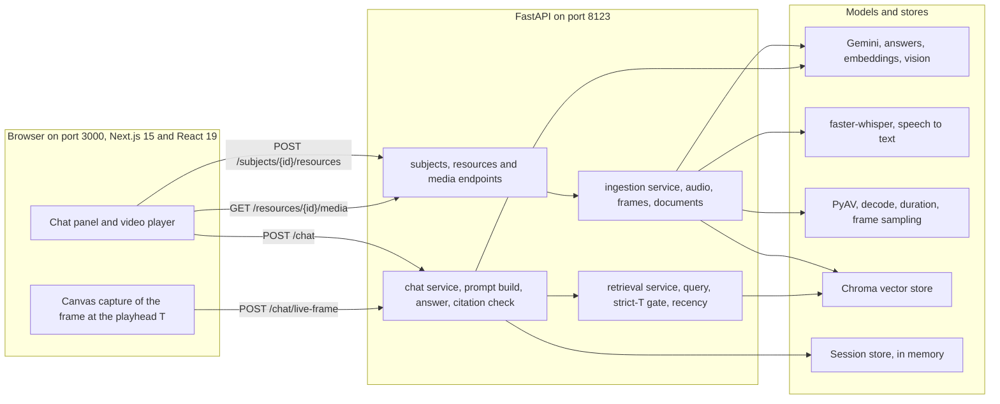
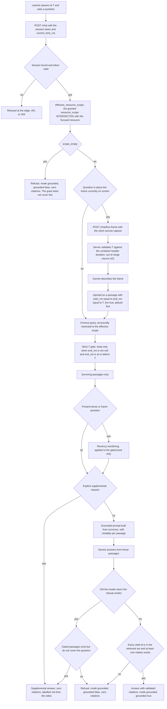
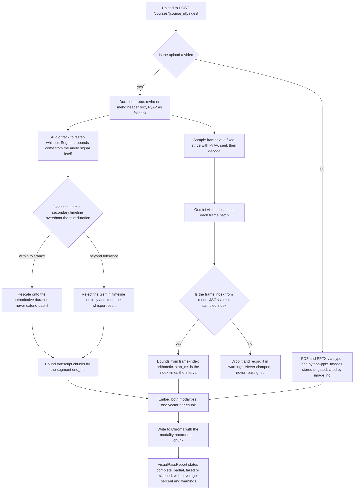
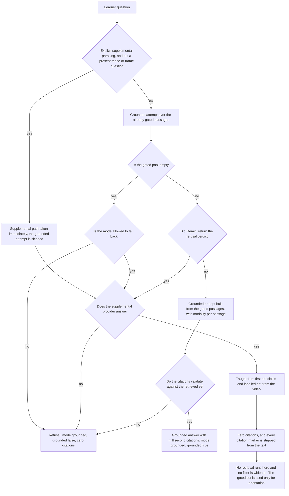
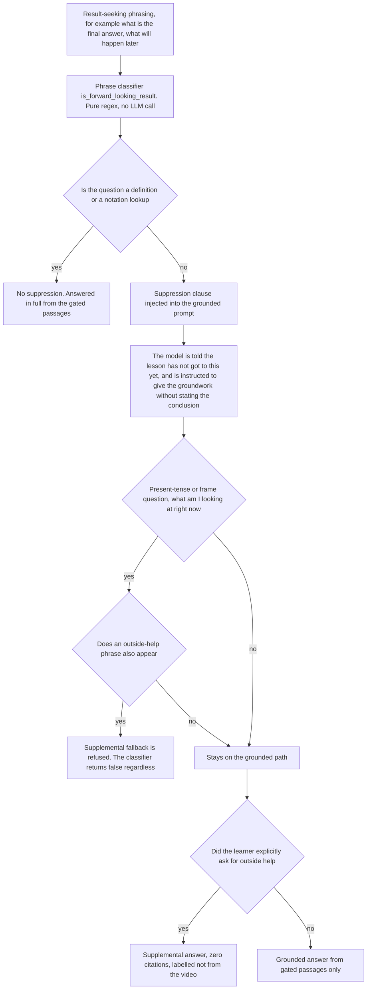
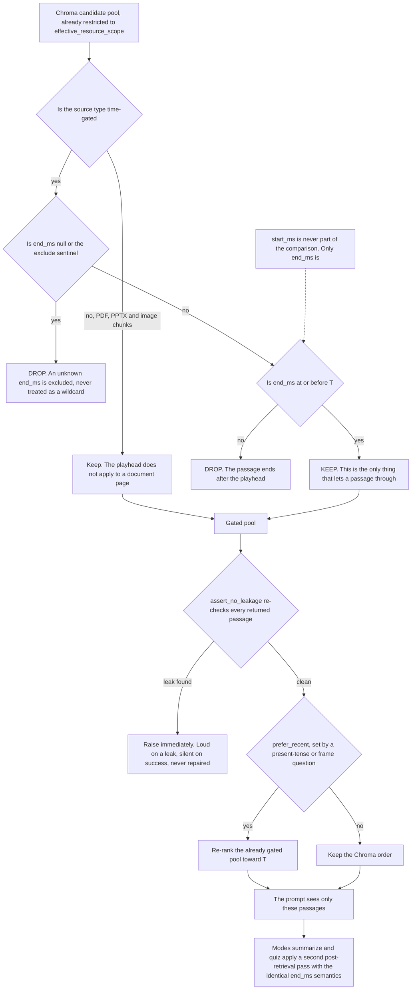

# PROJECT.md: Malai Pioneer

Last updated: 2026-10-15

Every item below is tagged. The tags are the contract:

| Tag | Meaning |
|---|---|
| `[SHIPPED]` | Implemented and verified by a command or a live probe recorded in this repo |
| `[PLANNED]` | Designed, not landed. May or may not land |
| `[PARTIAL]` | Works, but the scope is narrower than the name suggests |
| `[KNOWN LIMITATION]` | A real gap we are stating rather than hiding |

Nothing here is marked `[SHIPPED]` unless it passed a command or a live probe.

---

## 1. What it is

Malai Pioneer is a lecture-aware AI tutor. A student opens a video lecture in a
browser, watches it, and asks questions at the playhead. The tutor answers only
from what has already played, at or before the current timestamp, and it cites
every claim as a passage with a concrete millisecond range, labelled by whether
the evidence came from the speaker's voice or from a frame on screen. If the
lecture has not covered the question by that point in time, the system refuses
rather than inventing. The hard part is not the chat. The hard part is making
"only what has been said so far" a property the retrieval layer can prove, and
making every citation traceable back to a specific moment in a specific video.

---

## 2. Status at a glance

| Area | `[SHIPPED]` | `[PLANNED]` | `[KNOWN LIMITATION]` |
|---|---|---|---|
| Grounding | Strict timestamp gate (`end_ms <= T`) | Grounded vs Supplemental answering | Over-rigid refusal shape |
| Evidence | Citation modality tag, citation validation | Postgres + pgvector (sessions are in memory) | Sessions do not survive a restart |
| Visual | Live frame capture, full-coverage frame sampling | Delete-resource endpoint | Visual pass untested past 11 min |
| Ingest | Video, PDF, PPTX, image | True batched embedding (in progress, uncommitted) | 7-min video took over 7 min to ingest |
| Web | LaTeX rendering, session-grant recovery | Persistence layer | Unsigned launch is localhost-demo only |
| Coverage | 2 videos end to end | Long-form and multi-subject matrix | No long-form, no multi-page, no scale |

Read the second column as work in a diff, not work in a release.

---

## 3. Architecture

```
Browser (Next.js 15, React 19, Tailwind v3)  :3000
   |  chat POST /chat   |  ingest POST /courses/{id}/ingest
   v
FastAPI  :8123
   |-- app/ingestion/     audio -> faster-whisper, frames -> Gemini vision,
   |                      documents -> pypdf / python-pptx, splitter -> LangChain
   |-- app/retrieval/     Chroma query -> strict-T gate -> recency reorder
   |-- app/chat/          prompt build -> Gemini answer -> citation validation
   v
Chroma (vector store)   Gemini gemini-3.5-flash-lite (answers)
                        Gemini gemini-embedding-2 (embeddings)
                        PyAV (decode, duration, frame sampling)
```



*What to take from this: one FastAPI process owns every policy decision. The
browser only plays media, captures a canvas frame, and posts. Chroma stores
time-bounded chunks; Gemini is used for answers, embeddings and vision; the
strict-T gate lives in the retrieval layer, not in a prompt.*

### Request path for a question

1. Client posts the session token and the current playhead `T`.
2. Server validates the token, then **intersects** `focus_resource_id` with the
   granted `resource_scope`. Intersection, never replacement.
3. Chroma returns a candidate pool.
4. The gate drops every passage where `end_ms > T`. A null `end_ms` is the
   EXCLUDE sentinel, not a wildcard.
5. If the question is present-tense, recency reorders the **already gated**
   pool. Recency never widens it.
6. Prompt is built from survivors only, with modality per passage.
7. Gemini answers. Every returned citation id is checked against the retrieved
   set. An uncited or unknown-id answer is refused, not passed through.



*What to take from this: the gate is structural and sits before any reordering,
any supplemental decision and any model call. Two exits only: a grounded answer
that carries validated millisecond citations, or a refusal. A live frame passes
the gate by equality, so the gate itself has no special case.*

### Ingest path for a video

1. PyAV reads the real duration from the container header.
2. Audio track -> faster-whisper. Transcript timestamps come from the audio
   signal itself.
3. Frames sampled at a fixed stride. Gemini vision describes each batch. Frame
   timestamps come from **frame-index arithmetic**, never from the model's reply.
4. LangChain text splitters bound transcript chunks. Frame descriptions are
   instants and are **not** split.
5. Embeddings for both modalities land in Chroma.
6. A `VisualPassReport` records complete / partial / failed / skipped, plus a
   coverage percentage and any warnings.



*What to take from this: the language model describes, it never places anything
in time. Audio timestamps come from the ASR signal, visual timestamps come from
index arithmetic, and the two rejection guards are what keep a hallucinated
index or an overshooting timeline out of the index.*

### Demo content, as actually ingested

| Item | Value |
|---|---|
| subject_id | `sub_06dea46b30bf4ee7` "Engineering Mathematics" |
| resource 1 | `res_2e629d682a3d` "Partial-derivatives.mp4", 655.5 s |
| transcript chunks | 89, spanning `0..656380 ms` |
| visual chunks | 174, from 164 sampled frames, spanning `0..652000 ms` |
| visual coverage | **100%** |
| resource 2 | `res_455e9ec64f94` "Differential-equation-introduction-SnapYT.App.mp4" |

---

## 4. Feature inventory

| # | Feature | Tag | Note |
|---|---|---|---|
| 1 | Strict timestamp gate | `[SHIPPED]` | Passage kept only when `end_ms <= T`. Null excludes. Never `start_ms`. Refusal verified at T=2s. |
| 2 | Live frame capture | `[SHIPPED]` | Client canvas capture of the exact frame at T. Modelled as a passage with `start_ms == end_ms == T`, so it satisfies the gate by equality and needs no special case in the gate. Button or phrasing trigger. Server validates T against the container-header duration; the request carries no duration field. Out of range returns 422, never clamped. |
| 3 | Citation modality | `[SHIPPED]` | Every citation says `transcript` or `visual`. Unknown provenance maps to null, never defaulted to transcript. |
| 4 | Dual-media indexing | `[SHIPPED]` | Audio timestamps from the audio signal. Visual timestamps from frame-index arithmetic. |
| 5 | Recency-aware retrieval | `[SHIPPED]` | Present-tense questions prefer passages near the playhead. Applied strictly downstream of the gate. Colour and shape questions are deliberately not recency-seeking. |
| 6 | LaTeX rendering | `[SHIPPED]` | react-markdown + remark-math + rehype-katex. No `rehype-raw`, so model HTML stays inert. KaTeX `trust: false`. contract-check walks `app/`, `components/`, `lib/` for `rehype-raw` imports. |
| 7 | Multi-format ingest | `[SHIPPED]` | Video, PDF, PPTX, image. Images are deliberately **not** time-gated, treated like a PDF page, because a null `end_ms` is the exclude sentinel and gating would make an image permanently invisible. Image citations carry `image_no`, not a timestamp. |
| 8 | Subject-scoped resources, direct file upload | `[SHIPPED]` | Upload lands in a subject, not an orphan course. |
| 9 | Session-grant recovery | `[SHIPPED]` | A session whose granted materials changed re-mints on load instead of refusing forever. |
| 10 | `scope_empty` | `[SHIPPED]` | Separates "your grant does not cover this" from "you have not watched enough", so the UI stops blaming the learner for a stale grant. |
| 11 | Grounded vs Supplemental answering | `[PLANNED]` | When the lecture has not covered a question, answer from first principles and **label** it as not-from-video with zero citations. Forward-looking anti-spoiler suppression. Teaching-assistant register. In progress, may land today. |
| 12 | True batched embedding | `[PLANNED]` | Currently uncommitted work in the working tree. See decision D2. |
| 13 | Delete-resource endpoint | `[PLANNED]` | `purge_resource` exists and removes chunks plus the staged asset, but has no HTTP surface and does not detach from subjects. Needs a course-ownership check and subject detach first. |
| 14 | Postgres + pgvector | `[PLANNED]` | Sessions are in memory today. |

### How the grounded and supplemental paths diverge



*What to take from this: supplemental is reachable on exactly two narrow
triggers, an explicit request or a grounded refusal that found no coverage. A
citation-validation failure is a grounding defect and never escalates to
supplemental, because that would launder a broken answer into a plausible one.*

### Anti-spoiler suppression and the anti-over-refusal carve-out



*What to take from this: the gate removes future passages, so the remaining
spoiler risk is the model inferring a conclusion from earlier material. That is
handled at prompt level, and it is deliberately narrow, because a learner asking
what a partial derivative is at 0:30 must be answered, not refused.*

---

## 5. Technical decision log

### D1. Use proven libraries, keep policy in house

**`[SHIPPED]`**

Transcription (faster-whisper), vision (Gemini), chunking (LangChain splitters),
vector storage (Chroma), document parsing (pypdf, python-pptx) and decode
(PyAV) are all libraries. We did not write any of them.

Two things we refused to outsource:

- **The strict-T gate.** No retrieval library expresses "only what has been
  heard before T". It is one filter, but it is the product.
- **Citation validation.** Checking returned ids against the retrieved set is
  ten lines. Any framework that lets an answer through unvalidated gives us
  nothing to stand on.

**Rejected:** a hosted RAG platform with built-in video handling. It would not
expose a gate we control, and product policy we cannot edit is not a policy.

**Trade-off:** more of our own code to test, in exchange for invariants we can
actually assert. The 276-test suite is the price.

### D2. Batching for ingestion cost and latency

**`[SHIPPED]` as behaviour, `[PLANNED]` as fix**

Measured: ingesting a 7-minute video took over 7 minutes, dominated by
embedding. Root cause: `batchEmbedContents` given N texts returns **one pooled
vector** for the lot, not N vectors. The embedder discovered this and fell
back to one HTTP call per chunk, roughly 253 sequential calls for an 11-minute
video. Against the Gemini free tier's 100 requests/min floor, that is a hard
floor of about 2.5 minutes for embeddings alone.

Note the distinction: **batching** is fewer requests carrying more work
(throughput). **Parallelism** is more requests in flight (latency). This stall
was a batching failure, so more parallelism would only have made the rate
limiter angrier.

Planned fix: call `embedContent` with an array of N sub-requests, which is the
shape the REST body `{"requests": [...]}` actually batches on, and verify
`len(embeddings) == len(sent)`. Uncommitted in the working tree as of this
writing. It also raises `EmbeddingAlignmentError` rather than indexing, because
every downstream consumer zips vectors to chunks **positionally**, and a
mis-ordered response would attach the wrong vector to the wrong chunk with no
error anywhere.

**Trade-off:** the alignment check is deliberately fail-loud. A failed ingest is
recoverable. Quietly wrong embeddings are not, and they degrade retrieval
without ever reporting anything.

### D3. Timestamp authority: never trust the model's framing of a fact

**`[SHIPPED]`**

Three real bugs came from taking a timestamp or an index from something that
guessed at it.

1. **Gemini's audio timeline overshot** the real duration. A guard now rejects
   any segment past the container-header duration.
2. **The frame index came from model JSON.** A frame sampled at 650 s but
   labelled `index: 5` would be stored at `start_ms=20000`, and the gate would
   happily release it at T=20 s. That is a spoiler leak through the exact
   component meant to prevent spoilers. Indices are now validated at two levels
   against the sampler's real indices. Unknown indices are dropped and recorded,
   never clamped or reassigned.
3. **Character-proportion time-splitting** was applied to frame descriptions.
   Splitting by character share is correct for continuous speech and wrong for
   an instant. It produced a 135 ms citation reading "with respect to $y$: ...",
   the trailing 3.4% of the parent description cut mid-sentence.

The rule now: timestamps come only from the audio signal or frame-index
arithmetic. A language model describes. It does not get to place things in time.

**Trade-off:** we throw away model-supplied indices that may often be right.
Cheap correctness beats clever accuracy.

### D4. Why RAG and not a long-context window over the video

**`[SHIPPED]`**

A 10-minute lecture produces roughly 253 chunks across two modalities. You
cannot hand a video to a long-context window; there is no such endpoint, only
text. You would have to transcribe and caption it first, which is the same work,
minus the index. On top of that, long-context is more expensive per query and
returns a paragraph of blended context with no way to point at the 28th second.

Embeddings over **time-bounded** chunks are what make citation possible at all.
If you want to say "that came from 28.0 s", you need an addressable unit, and the
address has to be a millisecond range. Time-bounded chunks are that address.
The timestamp gate is then a filter over addresses, not a hope.

**Trade-off:** retrieval quality becomes a real engineering concern instead of
something the model does for you. In exchange, refusals are provable.

### D5. Silence is a bug we once shipped

**`[SHIPPED]`**

Visual coverage was silently capped at 24% of the video. A hardcoded
`max_visual_frames=40` fed a `break`, so 40 frames at 4 s covered only
`0..156 s` of a 655 s video. The entire visual pass was wrapped in
`except Exception: log.warning`. The job reported **success**. The suite was
fully green. A judge watching the product would have seen 76% of the video
invisible and had no way to know.

Now a `VisualPassReport` states complete / partial / failed / skipped, with a
coverage percentage and warnings. Degradation is stated, never inferred from a
count.

This is the single most important lesson in the repo: **green tests have
repeatedly hidden real bugs here.** A missing React import passed `tsc`. A
ChatPanel prefix bug shipped past a green suite. Live probes are mandatory
before claiming success, and `PROJECT.md` exists partly to force that habit
onto paper.

### D6. Honest empty states over invented content

**`[SHIPPED]`**

No fabricated titles, descriptions or timestamps, ever. A failed image
description fails the job rather than indexing invented text. Documents
degrade explicitly when there is no frame to capture, instead of pretending a
PDF page had a timeline.

**Trade-off:** more visible failures to the user. A job that fails loudly costs
a retry; a job that succeeds with invented content costs the trust of everyone
who reads a citation.

### D7. Cache and rate-limit strategy

**`[SHIPPED]`**

- `batchEmbedContents` pooling forces per-text embedding fallback, shared
  through a single `backoff.py` with bounded retries.
- Describe passes are paced under the 15 requests/min vision limit.
- Live frames are cached per (resource, second), so re-asking about the same
  moment does not re-hit the model.
- Free-tier behaviour is documented as expected: 429 `RESOURCE_EXHAUSTED` under
  load, wait about 90 s, retry once, never retry-loop.

### D8. Stated plainly: what this has not been through

**`[KNOWN LIMITATION]`**

- Only two 11-minute videos exercised end to end.
- YouTube ingest cannot be verified in this environment (captions and download
  unavailable).
- Sessions are in memory. A restart loses them.

---

## 6. Live verified probes

`res_2e629d682a3d`, 655.5 s. These are recorded probe results, not aspirations.

| T (ms) | Question | Result | Cited (ms) | Modality |
|---|---|---|---|---|
| 2 000 | What is written on the board? | **REFUSED**, strict-T correct | - | - |
| 30 000 | What equation is on screen? | answered | 28 000 | visual |
| 600 000 | What colour is the curve? | **REFUSED**, curve is early, honest | - | - |
| 300 000 | what is a partial derivative? | answered | 23 000, 284 010 | transcript |
| 480 000 | live frame capture | answered, `live: true` | 480 000 | visual |
| 30 000 | explain eigenvalues | **REFUSED**, this is the known weakness being fixed | - | - |

Every citation satisfies `end_ms <= T`. No gate breaches observed.

The T=2 000 refusal is the important row: at two seconds, nothing has been said,
and the system says so instead of inventing content from a lecture the student
has not heard. The T=30 000 eigenvalues refusal is the same mechanism behaving
too bluntly, which is what decision D9 addresses.

---

## 7. Metrics

All measured, with conditions stated.

| Metric | Value | Condition |
|---|---|---|
| Backend tests | **276 pass** | full pytest run, ruff clean |
| Frontend types | clean | `tsc --noEmit` |
| Frontend build | pass | `npm run build` |
| Contract check | **PASS, 77 assertions** | `npm run contract-check` |
| Visual coverage | **100%** | 164 frames sampled across 655.5 s |
| Indexed chunks (demo) | 89 transcript + 174 visual | `res_2e629d682a3d` |
| Strict-T refusals verified | 2 (T=2 000, T=600 000) | live probe |
| Live frame citation accuracy | citation exactly at T=480 000 | live probe |
| Ingest wall time | >7 min for a 7-min video | dominated by per-chunk embedding, see D2 |

The last row is included deliberately. It is the worst number in this document
and it is the one with a fix in progress.

---

## 8. Known problems

Stated, not softened.

1. **Over-rigid grounding.** Uncovered questions get refusal-shaped
   non-answers. This is the direct cost of D5 and D6, and it is being fixed
   with Supplemental answering (feature 11, `[PLANNED]`). Until it lands, the
   honest limitation is: the tutor is better at saying "not yet" than at saying
   "here is the idea anyway, and it is not from your lecture".
2. **Ingest is slow.** >7 minutes for a 7-minute video, dominated by
   per-chunk embedding. Batched embedding is in progress and uncommitted.
3. **Scale is untested.** Two videos. No long-form, no multi-page documents at
   scale, no multi-subject matrix, no load testing.
4. **Sessions do not persist.** In memory. Postgres + pgvector is planned.
5. **YouTube ingest is unverified.** Captions and download unavailable here.
6. **Unsigned launch is a demo setting.** `ALLOW_UNSIGNED_LAUNCH=true` and
   `LMS_LAUNCH_SECRET=dev-secret` are localhost-demo only. Production requires
   real HMAC-signed launches. This is a hard boundary, not a backlog item.
7. **No delete-resource surface.** Purge capability exists, no endpoint, no
   subject detach.
8. **Cross-origin canvas is a silent-failure trap.** The page is `:3000` and
   media is `:8123`, so `toBlob` needs `crossOrigin="anonymous"` on the
   `<video>` element. Without it, live-frame capture fails silently while every
   test passes.

---

## 9. Roadmap

Ordered by what unblocks the most honest behaviour, not by what is easiest.

| Priority | Item | Tag | Why now |
|---|---|---|---|
| 1 | Grounded vs Supplemental answering | `[PLANNED]` | Turns the worst limitation into the product's best feature. Anti-spoiler suppression must land with it. |
| 2 | True batched embedding | `[PLANNED]` | Unblocks ingest for anything longer than 11 minutes. |
| 3 | Postgres + pgvector | `[PLANNED]` | Sessions and vectors outlive restarts. |
| 4 | Delete-resource endpoint with subject detach | `[PLANNED]` | Ownership check first, detach second, endpoint last. |
| 5 | Coverage matrix: long-form video, multi-page PDF, second subject | `[PLANNED]` | Turns "two videos" into evidence. |
| 6 | YouTube ingest verification | `[PLANNED]` | Needs a network path we do not currently have. |
| 7 | HMAC-signed launch enforcement | `[PLANNED]` | Required before any real deployment. |

---

## 10. Invariants that must not be weakened

These are product properties. Do not relax one to make a test pass.

1. **Strict timestamp gate.** Keep a passage only when `end_ms <= T`. Never
   `start_ms`. A null `end_ms` excludes. An earlier eval measured a **48%
   production-gap rate** with a loose gate.
2. **Citations are validated.** Uncited or unknown-id answers are refused.
3. **Scope is intersected, not replaced.** `focus_resource_id` intersected with
   `resource_scope`. Replacing it was a real past bug.
4. **Plausible-looking ids are not real ids.** A scope of `["res_video", ...]`
   matches no indexed chunk and silently refuses every query. Scope ids must
   correspond to actually-indexed chunks.
5. **Secrets.** `apps/api/.env` holds Gemini keys and the launch secret. Never
   committed, never echoed, never read into a brief.
6. **Dev launch settings are demo-only.** See limitation 6 above.



*What to take from this: the comparison is end_ms at or before T and nothing
else. A null end_ms excludes rather than admitting the chunk, and recency
reordering happens strictly after the gate so it can only ever reorder survivors,
never reintroduce a passage that ended after the playhead.*

---

## 11. Reference

| Path | What it holds |
|---|---|
| `docs/HANDOFF.md` | Current verified state, routing, gotchas |
| `apps/api/app/retrieval/service.py` | Retrieval and the strict-T gate |
| `apps/api/app/retrieval/recency.py` | Recency preference |
| `apps/api/app/chat/service.py` | Prompt build and citation validation |
| `apps/api/app/ingestion/visual.py` | Frame sampling and index validation |
| `apps/api/app/ingestion/liveframe.py` | Live frame passages |
| `apps/api/app/ingestion/images.py` | Image ingest, non-time-gated |
| `apps/api/app/ingestion/embedder.py` | Embedding, batching work in progress |
| `apps/api/app/ingestion/backoff.py` | Shared bounded retries |
| `apps/api/app/ingestion/purge.py` | Purge, no HTTP surface yet |
| `apps/web/components/ChatPanel.tsx` | Chat UI, refusal copy |
| `apps/web/components/MarkdownBody.tsx` | LaTeX, no rehype-raw |
| `apps/web/components/LearnSessionProvider.tsx` | Grant re-minting |
| `docs/adr/ADR-001-lms-integration-scalability.md` | LMS boundary |
| `docs/adr/ADR-002-retrieval-stack-library-migration.md` | Library and persistence decisions |

Ports: API `8123`, web `3000`.

---

## 12. How to verify this document

Do not trust it. Run these.

| Claim | Command |
|---|---|
| 276 tests, ruff clean | `pytest` in `apps/api` |
| Frontend types and build | `tsc --noEmit`, `npm run build` in `apps/web` |
| Contract check, 77 assertions | `npm run contract-check` in `apps/web` |
| Strict-T refusal at T=2s | live probe, section 6 |
| Visual coverage 100% | the `VisualPassReport` on the ingest job |
| Batched embedding | **not verifiable yet**, uncommitted |

If a row in this document disagrees with a command, the command wins and this
document is wrong.