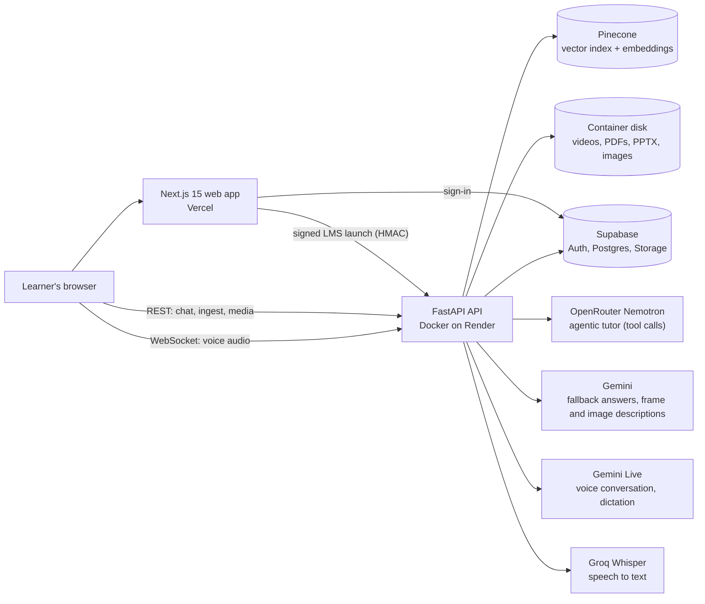

# Malai Pioneer: AI Learning Assistant

**AHGV BuildVerse 2026, Problem Statement 1.**

> **AHGV evaluators:** every submission deliverable (architecture diagrams, API
> documentation, sample dataset, evaluation results and testing, deployment
> instructions) is in the [`submission/`](submission/) folder. Start with its
> [index](submission/README.md). Setup instructions are in this README under
> [Quickstart](#quickstart-local).

Malai Pioneer is a lecture-aware AI tutor. A student watches a recorded lecture,
pauses at any moment, and asks a question. The tutor answers only from what has
already played: every passage it may use must end at or before the playhead, so
it never spoils what comes next. Every answer cites the exact moments it relied
on, and clicking a citation seeks the video there or opens the PDF page with
the cited text highlighted. When the lecture has not yet covered the question,
the tutor says so instead of inventing an answer. It reads the speech, what is
written on the screen, and any PDF, PowerPoint or image attached to the subject.
A Quiz tab writes practice quizzes (multiple choice, numerical, written) on what
has been watched. Answers stream in as they are written, and every video, PDF
and slide deck gets automatic chapters. Outside a lesson, the Malai page is a
standalone tutor chat: chats filed under a subject read only that subject's
materials, and chats in no subject answer from general knowledge. Learners can
also talk to the tutor out loud (Gemini Live). Spoken questions go through the
same checked pipeline, and the spoken turns appear in the chat. With Supabase
configured, learners sign in, and their subjects, chats, study activity and
uploaded files are saved to their account.

## Live demo

| What | Link |
|---|---|
| Web app (Vercel) | `https://ailearn-theta.vercel.app` |
| API (Render, Docker) | `https://malai-pioneer-api.onrender.com` |
| Interactive API docs (Swagger UI) | `https://malai-pioneer-api.onrender.com/docs` |
| API reference (ReDoc) | `https://malai-pioneer-api.onrender.com/redoc` |
| Health check | `https://malai-pioneer-api.onrender.com/health` returns `{"status": "ok"}` |

Suggested walkthrough: open `https://ailearn-theta.vercel.app`, go to the dashboard and open the
**Engineering Mathematics** subject, which already holds `Partial-derivatives.mp4`
and the `UNIT-1-001.pdf` notes.
Play it and pause at about 0:30, then ask "What is the final worked example at
the end of the video?" The tutor says the lesson hasn't got there yet, and every
citation ends before 0:30. Pause at about 5:00 and ask "What equation is on
screen right now?" It answers from the moments just before the playhead; click
a citation to see its span on the scrub bar. Then open the **Quiz** tab, or
open the PDF and click a page citation to see the cited text highlighted. The
lesson panel's **Chapters** tab lists the video's chapters (3) and the PDF's (8).
Type `/` in the chat box for slash commands, or open **Malai** in the sidebar for
the standalone tutor chat. In any chat, drop or paste a screenshot of a problem
to ask about it, or press the microphone to talk to the tutor.

The API runs on Render's free tier, so the first request after about 15 idle
minutes takes up to a minute while it wakes.

## What makes it different

- **An agentic tutor whose tools cannot see the future.** Malai, the tutor,
  is a tool-calling model (NVIDIA Nemotron via OpenRouter). It decides
  whether to `search_lesson` for a concept or to read a stretch of the lecture
  with `get_lesson_content(from, to)`, for example to write exam questions on
  everything watched so far. It never decides what it may see: both tools clamp
  to the playhead and the granted scope in code, and every id it cites must be
  one a tool returned in that turn. The server prefetches the lesson read
  before the first call, so most answers take one model call. Greetings and
  "who are you" get a short conversational reply with no citations. Any agent failure, such as a quota
  limit, a timeout or an invented citation, falls back to the classic pipeline
  below. The tutor never serves an unchecked answer.
- **No spoilers, enforced by the retrieval layer.** A video passage is kept only
  when `end_ms <= T`, where `T` is the playhead. The filter is inside the vector
  query and is checked again in Python. A passage with no known end is dropped.
  The prompt does not decide this; retrieval does. Eval leakage rate: **0.0**
  ([submission/EVALUATION.md](submission/EVALUATION.md)).
- **Citations are checked, and clicking one seeks the video.** Every citation
  id the model returns is compared against the passages actually retrieved. An
  answer with no citation, or with an id that was not retrieved, is refused.
  Each citation carries its millisecond range and whether it came from the
  audio or from a frame.
- **It refuses instead of making things up.** It refuses when nothing before `T`
  covers the question, when the session's grant does not cover the resource
  (`scope_empty`), and when that part of the video has not been processed yet.
  Each refusal states its reason.
- **Ask about this frame.** The browser captures the exact frame on screen. The
  server describes it and adds it as a passage at `start_ms == end_ms == T`, so
  it passes the gate by equality and the gate needs no special case.
- **Recency-aware retrieval.** Present-tense questions ("what is he writing
  now?") prefer passages near the playhead. Re-ranking happens after the gate,
  so it can never widen what is visible.
- **Progressive (stream) ingest.** Video is processed in 120 s windows. Each
  window runs a fast transcript stage first and a slower visual stage after it.
  In `stream` mode the first three windows are processed at upload, and the
  player's position heartbeat queues later windows ahead of the learner. Students
  can ask questions within the first windows instead of waiting for the whole
  video.
- **Multimodal.** Indexes the transcript (Groq `whisper-large-v3-turbo`, with
  local faster-whisper as a fallback), frame descriptions (Gemini vision, one
  frame every 4 s, with near-duplicate frames skipped), PDF and PPTX text, and
  images. Optional OCR handles scanned PDFs.
- **Real practice quizzes, in every chat.** A Quiz tab writes multiple-choice,
  numerical and written questions on what has been watched (plus materials
  marked done), in one model call through the same playhead gate, and every
  question cites its source. The tab is a form: 1-20 questions, question types
  and optional instructions. Asking in plain words ("quiz me on...") opens it
  too. The server writes the quiz start and the score into the chat
  (`POST /quiz/note`). Malai chats get subject-scoped quizzes, or
  general-knowledge quizzes when the chat is in no subject. Multiple-choice and
  numerical answers are checked in the browser with no model call; only written
  answers are graded by the model
  ([diagram](submission/ARCHITECTURE.md#d-practice-quizzes)).
- **Streaming answers.** `POST /chat/stream` (Server-Sent Events) sends status
  lines, then the answer so far with citation markers stripped, then the
  validated `ChatResponse`, which replaces the preview. Gemini streams token by
  token; the agent path shows status lines until its answer is ready. Citation
  validation is unchanged: the preview is never the final answer. `POST /chat`
  is unchanged.
- **Automatic chapters.** After ingest, videos get timestamped chapters and
  PDFs and slide decks get page or slide ranges (`GET /resources/{id}/chapters`,
  shown in the lesson panel's Chapters tab). They are stored as
  `data/chapters/<resource_id>.json` (`CHAPTERS_DIR` overrides) and regenerated
  when stale.
- **Slash commands.** Every chat, in a lesson or in Malai, offers `/explain`,
  `/analogy`, `/summarize`, `/compare` and `/quiz`. Typing `/` opens a menu with
  each command's options, worded for what that chat can read (a video, a
  document, a subject, or nothing).
- **Shows exactly what it cites.** Clicking a citation from the open PDF opens
  that page with the cited text highlighted. A video citation seeks there and
  draws the cited span as a band on the scrub bar; a live-frame citation seeks
  to the captured moment. PDFs, slides and images open in viewers beside the
  tutor.
- **Reads the open material plus what you finished.** A chat reads the open
  material up to the playhead, plus every material ticked done in the course
  checklist (in full), and nothing else. The done list is intersected with the
  session grant, so it can never widen what a learner may read.
- **Several chats per lesson.** Start, switch, rename and delete chats; each
  keeps its own history.
- **Malai, the standalone tutor chat (`/malai`).** Its own sidebar lists
  subjects with their chats, then unfiled recent chats, with search, rename,
  move into or out of a subject, and delete; it collapses to a rail. A subject
  page (`/malai?s=<id>`) shows its chats, resources and a start-a-chat box, and
  resources open beside Malai (`/malai/lesson/<subject>/<resource>`). A chat
  filed under a subject reads only that subject's materials:
  `scope_resource_ids` narrows the session grant by intersection, so it can
  only remove. The strict `end_ms <= T` gate is unchanged; with no playhead,
  Malai reads documents and videos marked done.
- **General chats.** A Malai chat in no subject is answered from general
  knowledge, with no retrieval and zero citations (mode `"general"`), unless
  the message points at the learner's materials ("my notes", "the lecture",
  "the uploaded pdf"), which sends it through the normal grounded pipeline.
- **Dockable lesson page.** The lesson and Malai are two windows. Drag a grip to
  dock either to any edge, side by side or stacked, swap them, resize the
  divider, collapse the panel or hide the video. The layout is remembered per
  browser. Resources opened from My subjects show without the chat, with an
  "Open with Malai" button.
- **Dashboard and My subjects.** The dashboard shows a year of study activity
  (streak, study days, time spent), continue learning, the next practice quiz
  and recent subjects. My subjects has search, Ongoing/Completed/Archived
  filters, sorting and a grid or list view. Activity, progress and archiving
  are stored in the browser.
- **Math and Markdown render properly.** Answers are Markdown with LaTeX
  (KaTeX): headings, lists, code blocks with Copy, and tables (remark-gfm).
  `\(..\)` and `\[..\]` are rewritten to dollar forms, display math is centred
  and key equations are larger. Raw HTML from the model is never rendered.
- **Replies in the learner's language and tone.** The tutor answers in the
  language the learner writes in and matches their register.
- **Voice conversations.** A microphone button in every chat starts a live
  voice session (`WS /voice/live`, Gemini 3.8 Live, 3.8 Live with extended
  thinking, or 2.5 Flash Native Audio). The voice bar replaces the input box
  while you talk, and each spoken question and answer appears in the chat as
  a normal message. The voice model does not answer course questions itself:
  it calls one tool, `ask_course`, which runs the same pipeline as `POST /chat`
  (playhead gate, citation validation, refusals) with the live playhead, and
  it reads out that checked answer. The extended-thinking model emits no tool
  calls, so the server answers the transcribed question and passes the result
  for the model to speak. A recap of the conversation is saved to the chat every
  5 minutes and when the session ends. You can pick from several voices and
  speaking tones. Separately, a dictation button streams speech into the input
  box (`WS /voice/transcribe`). The Gemini key stays on the server, which
  relays the audio.
- **Images in the chat.** Attach images with the image button, by dragging
  them onto the chat, or by pasting a screenshot. Each image is read once by
  Gemini vision: its text and math are copied as LaTeX and its figures are
  described. Every later answer in that chat sees the transcript. Images belong
  to the chat, not the subject: they are never indexed and never cited as
  course material, and the gate and citation checks are unchanged. With
  Supabase, the file is kept in Storage under the learner's folder.
- **Chats name themselves.** The first question's title is written alongside
  the first answer (a separate small model call, given at most 4 s) and sent
  in the final event of the stream.
- **Accounts and cloud sync (Supabase).** Email and password or Google sign-in.
  The API verifies the Supabase JWT and binds each session to its user.
  Subjects, chat sessions, threads, messages, the Malai chat list, chat images,
  study activity, lesson progress and quiz attempts are written to Postgres
  under row-level security, so they survive restarts and follow the learner to
  other devices. Uploaded videos, PDFs, slides and images are copied to the
  private `media` bucket and downloaded back if the server's local copy is gone.
  The demo lesson stays public. With no Supabase settings, all of this is off
  and the app behaves as it did before (local files).
- **Add content from anywhere.** The subject resources list in the Malai
  sidebar and the Malai subject page each have an **Add** button. It opens the
  same upload and YouTube ingest as the dashboard's Add content.
- **Personalization and Hinglish.** A personalization panel at the bottom of the
  Malai sidebar saves your name, what you study, preferred traits, language,
  answer length and extra instructions. They apply to text and voice answers as
  style only, so they never change what the tutor may read. Questions in Hindi
  or Hinglish get Hinglish answers in Roman script.
- **Says when it did less than asked.** Every ingest reports `visual_status`,
  `visual_coverage_pct` and warnings. A spent daily model quota returns a
  readable `503` and does not keep retrying.

## Architecture



More diagrams (hosting, ingest pipeline, question flow, practice quizzes, lesson page, accounts, voice) and the safety
invariants are in [submission/ARCHITECTURE.md](submission/ARCHITECTURE.md).

## Tech stack

| Layer | Technology |
|---|---|
| Web | Next.js 15, React 19, Tailwind CSS v3, react-markdown + remark-gfm + remark-math + rehype-katex (KaTeX pinned to ^0.16.47), Inter and JetBrains Mono, react-pdf (PDF viewer), Office Online embed (slides) |
| API | Python, FastAPI, Pydantic v2, uvicorn |
| Retrieval | Pinecone serverless (hosted) or Chroma on disk (local), LangChain text splitters |
| Tutor agent | `nvidia/nemotron-3.5-super-vl:free` via OpenRouter, OpenAI-format tool calling |
| LLM (quizzes, fallback pipeline) | Gemini `gemini-3.5-flash-lite` |
| Embeddings | Hosted: Pinecone Inference `llama-text-embed-v2` (1024-d), 96 texts per call, repeated queries cached. Local default: Gemini `gemini-embedding-2` (3072-d) |
| Vision | Gemini (frame and image descriptions, live frames, chat images) |
| Voice | Gemini Live (`gemini-3.8-live`, `gemini-3.8-live-extended-thinking`, `gemini-2.5-flash-native-audio-preview-12-2025`), dictation with `gemini-3.5-transcribe-live`, relayed by the API over WebSockets |
| Accounts, database, storage | Supabase Auth (email and password, Google), Postgres with row-level security, Storage (`media` bucket, private), all optional; `@supabase/ssr` on the web, a small httpx client in the API |
| Speech to text | Groq `whisper-large-v3-turbo`, with local faster-whisper as fallback |
| Media | PyAV (decode, duration, frame sampling), pypdf, python-pptx |
| File storage | Local disk (the demo video, PDF and their chapters are baked into the hosted image), mirrored to Supabase Storage when configured |
| Hosting | Vercel (web), Render Docker free tier (API: `render.yaml` for production, `render.dev.yaml` for the dev API) |
| Tests | pytest (backend), `tsc --noEmit` and a contract check (frontend) |

## Quickstart (local)

Prerequisites: Python 3.12 or newer (3.14 is used in development), Node.js 18 or
newer, and a Gemini API key. A Groq key is optional.

```bash
git clone <repo-url> && cd ailearn
cp apps/api/.env.example apps/api/.env          # then fill in LLM_API_KEY / EMBEDDING_API_KEY
cp apps/web/.env.example apps/web/.env.local
python -m pip install -r apps/api/requirements.txt
cd apps/web && npm install && cd ../..
```

**Windows, one click:** double-click `run.bat` at the repo root. It picks a
Python that can import `uvicorn` and `chromadb`, frees ports 8123 and 3000, starts
both servers, waits for `/health`, and prints the URLs. Press a key in its window
to stop both.

**Manual (any OS):**

```bash
# API - always start from apps/api so apps/api/.env is found
cd apps/api
python -m uvicorn app.main:app --port 8123

# Web - in another shell
cd apps/web
npm run dev -- --port 3000
```

Open http://localhost:3000. API docs are at http://localhost:8123/docs.
Locally, the vector store is Chroma under `apps/api/data/` and uploads are kept on
disk, so no cloud account is needed beyond the Gemini key.

To load the sample lecture, see [submission/DATASET.md](submission/DATASET.md).

### Pages

| Route | What it is |
|---|---|
| `/` | Landing page: what the tutor does, with Try demo, Log in and Sign up (or Dashboard when signed in) |
| `/login` | Sign in or sign up (`/login?mode=signup`), email and password or Google; `/auth/callback` finishes the sign-in |
| `/dashboard` | Study activity, Malai entry card, continue learning, next practice quiz, recent subjects |
| `/ai-tutor/subjects` | My subjects: search, Ongoing/Completed/Archived filters, sort, grid or list |
| `/ai-tutor/subjects/<subject>/content/<resource>` | A resource without the chat, with an "Open with Malai" button |
| `/malai` | Malai chat with its own sidebar; `/malai?s=<subject>` is a subject page |
| `/malai/lesson/<subject>/<resource>` | The lesson page: lesson window (player, Chapters / Transcript / Resources) and Malai window, dockable |
| `/dev` | Developer view, the live pipeline trace (a floating button opens it on desktop) |

The sidebar links Dashboard, My Subjects and Malai (Profile is a placeholder,
not implemented yet). With Supabase configured, `/dashboard`, `/ai-tutor/*` and
`/malai/*` need a signed-in user, except the demo lesson. In any chat, type
`/` for slash commands, or ask "quiz me on..." to open the quiz form.

### API endpoints added in this release

| Endpoint | Purpose |
|---|---|
| `POST /chat/stream` | Same request as `POST /chat`; Server-Sent Events with status lines, the answer so far, then the validated `ChatResponse` |
| `POST /quiz/note` | Writes a quiz start or score into the chat history |
| `GET /resources/{resource_id}/chapters` | Automatic chapters for a video, PDF or slide deck |
| `GET /voice/models`, `WS /voice/live`, `WS /voice/transcribe` | Voice: available models and voices, live conversation, dictation into the input box |
| `POST /chat/attachments`, `DELETE /chat/attachments/{id}` | Attach an image to one chat (read by Gemini vision) or take it back |
| `GET /malai/chats`, `PUT /malai/chats/{id}`, `DELETE /malai/chats/{id}` | The signed-in learner's Malai chat list, synced across devices |

`ChatRequest` also takes `scope_resource_ids` (narrows the session grant,
intersection only), `general` (a chat in no subject) and `personalization`
(style only). The stream's final `done` event carries `thread_title` when the
chat was just named. The full reference is
[submission/API.md](submission/API.md) and the live `/docs`.

## Environment variables

**API** (`apps/api/.env`, template `apps/api/.env.example`):

| Variable | Default | Purpose |
|---|---|---|
| `LLM_API_KEY` | empty | Gemini key for answers and vision. With no key the app uses a deterministic stub LLM |
| `EMBEDDING_API_KEY` | empty | Gemini key for embeddings (same value). With no key the app uses an offline hashing embedder (1536-d) |
| `LLM_MODEL` | `gemini-3.5-flash-lite` | Answer model |
| `EMBEDDING_MODEL` | `gemini-embedding-2` | Embedding model (3072-d) |
| `EMBEDDING_PROVIDER` | empty | `pinecone` embeds chunks and queries with Pinecone Inference (`PINECONE_API_KEY`, a 1024-d index). Empty keeps Gemini, or hashing with no key |
| `PINECONE_EMBED_MODEL` | `llama-text-embed-v2` | Pinecone Inference model (1024-d) |
| `OPENROUTER_API_KEY` | empty | Enables the agentic tutor. With no key, every question goes through the classic Gemini pipeline |
| `OPENROUTER_MODEL` | `nvidia/nemotron-3.5-super-vl:free` | Tutor model. It must support tool calling |
| `AGENT_MAX_STEPS` | `2` | Model calls per agent answer (the lesson read is prefetched; the second call is for a cite repair) |
| `AGENT_TIMEOUT_S` / `AGENT_TOTAL_TIMEOUT_S` | unset | Optional time limits per agent call / per answer. Unset means a slow free-tier reply is waited for, not cut off |
| `GROQ_API_KEY` | empty | Hosted transcription. With no key, local faster-whisper is used |
| `GROQ_TRANSCRIBE_MODEL` | `whisper-large-v3-turbo` | Groq model |
| `CORS_ORIGIN` | `http://localhost:3000` | The single allowed browser origin (`https://ailearn-theta.vercel.app` when hosted) |
| `LMS_LAUNCH_SECRET` | `dev-secret` | HMAC secret for LMS launches and session tokens. Must match the web app's secret |
| `ALLOW_UNSIGNED_LAUNCH` | `false` | `true` accepts unsigned launches. **Localhost demo only**; it works only together with `LMS_LAUNCH_SECRET=dev-secret` |
| `USE_IN_MEMORY` | `true` | Process-local sessions, mirrored to `data/` |
| `MAX_UPLOAD_MB` | `0` (no cap) | Upload size cap. Hosted deployments set one |
| `MAX_VIDEO_MINUTES` | `0` (no cap) | Video length cap, read from the container header before any model call |
| `MAX_UPLOADS_PER_HOUR` | `0` (no cap) | Global upload rate cap that protects the free model quota |
| `VECTOR_STORE` | `chroma` | `pinecone` on the hosted deployment *(hosted only)* |
| `PINECONE_API_KEY`, `PINECONE_INDEX` | none | Pinecone credentials and index name *(hosted only)* |
| `LOCAL_WHISPER_FALLBACK` | `true` | `false` on the hosted 512 MB instance: if Groq fails, the window fails visibly instead of loading a local model |
| `OCR_BACKEND` | off | `unlimited-ocr` enables OCR for scanned PDFs (needs an operator-installed GPU stack) |
| `CHAPTERS_DIR` | `data/chapters` | Where automatic chapter files are stored, one JSON file per resource |
| `SUPABASE_URL`, `SUPABASE_SERVICE_ROLE_KEY` | empty | Turn on Supabase persistence, Storage mirroring and JWT checks. Both must be set; with either empty, Supabase is off |
| `SUPABASE_JWT_SECRET` | empty | Only for legacy HS256 projects. Newer projects are verified through their JWKS |
| `SUPABASE_STORAGE_BUCKET` | `media` | Private bucket for uploads and chat images |
| `AUTH_REQUIRED` | `false` | `true` rejects anonymous uploads, deletes and subject changes with 401 (the demo course stays open) |
| `VOICE_LIVE_MODEL`, `VOICE_THINKING_MODEL`, `VOICE_NATIVE_AUDIO_MODEL`, `VOICE_TRANSCRIBE_MODEL` | see Tech stack | Gemini Live model ids, so a renamed model is a config change. Voice uses `LLM_API_KEY` |
| `VOICE_THINKING_LEVEL` | `medium` | `low`, `medium` or `high` for the extended-thinking voice model |

**Web** (`apps/web/.env.local` locally, Vercel project settings when hosted):

| Variable | Purpose |
|---|---|
| `NEXT_PUBLIC_API_URL` | API base URL (`http://localhost:8123` locally, `https://malai-pioneer-api.onrender.com` when hosted) |
| `LMS_LAUNCH_SECRET` | **Server-only.** A Next.js server route signs the LMS launch with it, so the hosted API can run with `ALLOW_UNSIGNED_LAUNCH=false` |
| `NEXT_PUBLIC_SUPABASE_URL`, `NEXT_PUBLIC_SUPABASE_ANON_KEY` | Supabase project URL and public (anon or publishable) key. Without them there is no sign-in and every page is open |

**Supabase setup (optional).** Create a project, then paste
`supabase/migrations/0001_init.sql`, `0002_malai_chats.sql` and
`0003_grants.sql`, in that order, into the SQL Editor. 0003 matters: without
its grants, every table call fails with `42501 permission denied`, even with
the service key, and the API only logs a warning, so nothing is saved.
`supabase/maintenance/clear_chats.sql` is a one-off script that wipes every
chat; it is not a migration.

Never commit `apps/api/.env`. It holds the API keys and the launch secret.

## Tests

```bash
cd apps/api
python -m pytest -q -p no:warnings        # backend suite (660 tests collected)
python -m pytest --co -q | tail -1        # confirm it collects with no errors
# RAG evaluation on the lecture + PDF (needs keys; see submission/EVALUATION.md):
python -m app.eval.harness --golden ../../submission/eval/golden-partial-derivatives.jsonl --chunks ../../submission/eval/partial-derivatives-chunks.jsonl --embedder pinecone

cd apps/web
npx tsc --noEmit                          # types
npm run contract-check                    # client/server contract + rendering safety
```

Current results and what each test file protects are listed in
[submission/EVALUATION.md](submission/EVALUATION.md).

## Branches and deploys

Work happens on `dev`; production deploys from `main`. CI runs on both
branches. `render.yaml` is the production API blueprint and `render.dev.yaml` a
separate blueprint for the dev API (`malai-pioneer-api-dev`, same Dockerfile,
built from `dev`), so testing on `dev` never touches the live site.

`apps/api/deploy/render/Dockerfile` bakes the demo video, the demo PDF,
`deploy/seed/subjects.json` and the demo chapters
(`deploy/seed/chapters/res_2e629d682a3d.json`, 3 chapters, and
`res_7c1f4a92d0e5.json`, 8 chapters) into the image. The chapters were generated
against the same Pinecone chunks, so they survive Render restarts with no model
calls. Full steps are in [submission/DEPLOYMENT.md](submission/DEPLOYMENT.md).

## Submission deliverables

All deliverables are in [submission/](submission/), and its
[index](submission/README.md) lists them.

| BuildVerse requirement | Where |
|---|---|
| Hosted, working application | [Live demo](#live-demo): `https://ailearn-theta.vercel.app` |
| Source code | This repository (`apps/api` backend, `apps/web` frontend) |
| System architecture diagram | [submission/ARCHITECTURE.md](submission/ARCHITECTURE.md); PNGs in [submission/diagrams/](submission/diagrams/) |
| README and setup | This file: [Quickstart](#quickstart-local), [Environment variables](#environment-variables) |
| API documentation | [submission/API.md](submission/API.md); live Swagger UI at `/docs` |
| Sample dataset | [submission/DATASET.md](submission/DATASET.md) and `test-data/` (lecture video and PDF notes); golden set in `submission/eval/` |
| Evaluation results and testing | [submission/EVALUATION.md](submission/EVALUATION.md); raw results in `submission/eval-results/` |
| Demo video | [submission/My Video-2.mp4](submission/My%20Video-2.mp4) |
| Deployment instructions | [submission/DEPLOYMENT.md](submission/DEPLOYMENT.md) |

## Known limitations

- **YouTube ingest is unreliable when hosted.** YouTube often blocks caption and
  video downloads from datacenter IPs such as Render's. Upload the file
  instead. YouTube ingest has also not been verified in the development
  environment.
- **Free-tier quotas limit throughput.** The hosted API embeds with Pinecone
  Inference (5M tokens a month on the free plan) instead of Gemini, whose free
  tier allows only about 1,000 embedding texts a day. Speech cues are merged
  into chunks of up to 30 s and frame descriptions three to a chunk, so a video
  needs 2-11x fewer embeddings (measured: the demo lecture 263 -> 118 chunks,
  a captioned lecture 193 -> 17). Frame descriptions
  still use Gemini's quota; when a daily quota runs out, ingest stops with a
  readable `503` until it resets. Hosted uploads are capped by size, length and
  rate.
- **Ingest job state lives in process memory.** Job status and the in-flight
  window guard are lost on restart. With Supabase configured, subjects,
  sessions, chats and chat images are written through to Postgres and loaded
  on startup, and uploaded files come back from Storage when the local copy is
  gone. Without Supabase they are mirrored to local files only, and Render's
  free disk is wiped on every restart and wake-up, so files uploaded on the
  hosted site disappear then (their index entries stay in Pinecone). The demo
  video and PDF survive either way because they are baked into the image.
  Chapters for other uploads live on that disk and are rebuilt the first time
  the resource is opened after a restart.
- **Supabase writes fail quietly.** Writes to Postgres are best effort: a
  failure is logged as a warning and the request still succeeds, so a project
  missing the `0003_grants.sql` privileges looks healthy but saves nothing.
- **Some browser state stays local.** Archiving and the dock layout live in
  the browser. Study activity, lesson progress and quiz attempts are synced to
  the account only when the learner is signed in.
- **Voice is capped at 10 minutes per session.** The voice model ids are
  previews and may be renamed, which is why they are settings. Voice answers
  take the faster classic pipeline (no agent) and are kept short for speech.
- **Chat images are read once.** Answers use the transcript, not the pixels.
  A chat keeps at most 10 images (8 MB each), and an answer sees the newest 5.
- **The Transcript tab is UI only.** It is not wired to the transcript yet.
- **Write routes are open unless `AUTH_REQUIRED=true`.** Upload, delete and
  subject routes take the Supabase user when one is signed in and can be
  switched to require one. The playhead `position` route is never gated. Chat,
  history, chats, quizzes, images and voice are always bound to a signed
  session.
- **The free tutor model is rate-limited.** OpenRouter's free tier allows 50
  requests a day (1,000 with $10 of credit). Each question now uses 1, or 2 when
  a citation repair is needed. Agent answers take about 5-20 s. When the limit
  is reached, answers come from the Gemini pipeline, which adds 15-20 s.
- **Small eval set.** The evaluation is 29 questions on one 11-minute lecture
  and one PDF (real embedder and real answers: 0 spoilers, 16 of 19 answered
  correctly). Concurrent load has not been measured.
