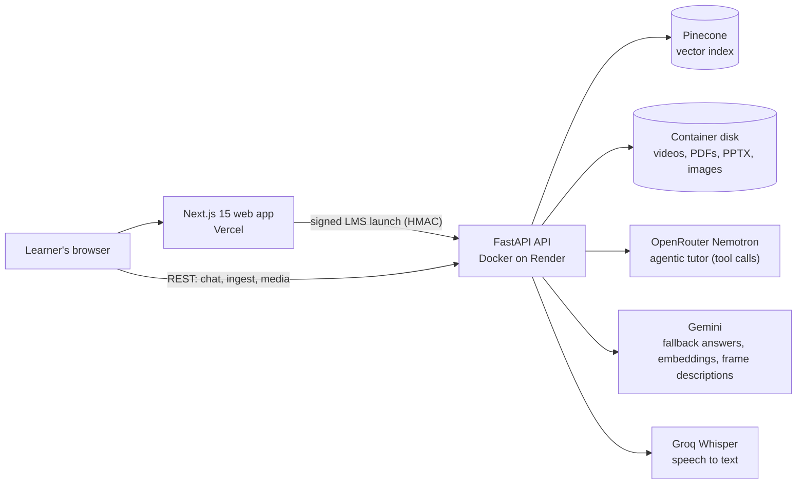

# Malai Pioneer: AI Learning Assistant

**AHGV BuildVerse 2026, Problem Statement 1.**

> **AHGV evaluators:** every submission deliverable (architecture diagrams, API
> documentation, sample dataset, evaluation results and testing, deployment
> instructions) is in the [`submission/`](submission/) folder. Start with its
> [index](submission/README.md). Setup instructions are in this README under
> [Quickstart](#quickstart-local).

Malai Pioneer is a lecture-aware AI tutor. A student watches a recorded lecture,
pauses at any moment, and asks a question. The tutor answers only from what has
already played: every passage it may use must end at or before the playhead, so
it never spoils what comes next. Every answer cites the exact moments it relied
on, and clicking a citation seeks the video there. When the lecture has not yet
covered the question, the tutor says so instead of inventing an answer. It reads
the speech, what is written on the screen, and any PDF, PowerPoint or image
attached to the subject.

## Live demo

| What | Link |
|---|---|
| Web app (Vercel) | `https://ailearn-theta.vercel.app` |
| API (Render, Docker) | `https://malai-pioneer-api.onrender.com` |
| Interactive API docs (Swagger UI) | `https://malai-pioneer-api.onrender.com/docs` |
| API reference (ReDoc) | `https://malai-pioneer-api.onrender.com/redoc` |
| Health check | `https://malai-pioneer-api.onrender.com/health` returns `{"status": "ok"}` |

Suggested walkthrough: open `https://ailearn-theta.vercel.app`, go to the dashboard and open the
**Engineering Mathematics** subject, which already holds `Partial-derivatives.mp4`.
Play it and pause at about 0:30, then ask "What is the final worked example at
the end of the video?" The tutor says the lesson hasn't got there yet, and every
citation ends before 0:30. Pause at about 5:00 and ask "What equation is on
screen right now?" It answers from the moments just before the playhead.

The API runs on Render's free tier, so the first request after about 15 idle
minutes takes up to a minute while it wakes.

## What makes it different

- **An agentic tutor whose tools cannot see the future.** Malai, the tutor,
  is a tool-calling model (NVIDIA Nemotron via OpenRouter). It decides
  whether to `search_lesson` for a concept or to read a stretch of the lecture
  with `get_lesson_content(from, to)`, for example to write exam questions on
  everything watched so far. It never decides what it may see: both tools clamp
  to the playhead and the granted scope in code, and every id it cites must be
  one a tool returned in that turn. Greetings and "who are you" get a short
  conversational reply with no citations. Any agent failure, such as a quota
  limit, a timeout or an invented citation, falls back to the classic pipeline
  below. The tutor never serves an unchecked answer.
- **No spoilers, enforced by the retrieval layer.** A video passage is kept only
  when `end_ms <= T`, where `T` is the playhead. The filter is inside the vector
  query and is checked again in Python. A passage with no known end is dropped.
  The prompt does not decide this; retrieval does. Eval leakage rate: **0.0**
  ([submission/EVALUATION.md](submission/EVALUATION.md)).
- **Citations are checked, and clicking one seeks the video.** Every citation
  id the model returns is compared against the passages actually retrieved. An
  answer with no citation, or with an id that was not retrieved, is refused.
  Each citation carries its millisecond range and whether it came from the
  audio or from a frame.
- **It refuses instead of making things up.** It refuses when nothing before `T`
  covers the question, when the session's grant does not cover the resource
  (`scope_empty`), and when that part of the video has not been processed yet.
  Each refusal states its reason.
- **Ask about this frame.** The browser captures the exact frame on screen. The
  server describes it and adds it as a passage at `start_ms == end_ms == T`, so
  it passes the gate by equality and the gate needs no special case.
- **Recency-aware retrieval.** Present-tense questions ("what is he writing
  now?") prefer passages near the playhead. Re-ranking happens after the gate,
  so it can never widen what is visible.
- **Progressive (stream) ingest.** Video is processed in 120 s windows. Each
  window runs a fast transcript stage first and a slower visual stage after it.
  In `stream` mode the first three windows are processed at upload, and the
  player's position heartbeat queues later windows ahead of the learner. Students
  can ask questions within the first windows instead of waiting for the whole
  video.
- **Multimodal.** Indexes the transcript (Groq `whisper-large-v3-turbo`, with
  local faster-whisper as a fallback), frame descriptions (Gemini vision, one
  frame every 4 s, with near-duplicate frames skipped), PDF and PPTX text, and
  images. Optional OCR handles scanned PDFs.
- **Math renders properly.** Answers are Markdown with LaTeX (KaTeX). Raw HTML
  from the model is never rendered.
- **Says when it did less than asked.** Every ingest reports `visual_status`,
  `visual_coverage_pct` and warnings. A spent daily model quota returns a
  readable `503` and does not keep retrying.

## Architecture



More diagrams (hosting, ingest pipeline, question flow) and the safety
invariants are in [submission/ARCHITECTURE.md](submission/ARCHITECTURE.md).

## Tech stack

| Layer | Technology |
|---|---|
| Web | Next.js 15, React 19, Tailwind CSS v3, react-markdown + remark-math + rehype-katex |
| API | Python, FastAPI, Pydantic v2, uvicorn |
| Retrieval | Pinecone serverless (hosted) or Chroma on disk (local), LangChain text splitters |
| Tutor agent | `nvidia/nemotron-3.5-super-vl:free` via OpenRouter, OpenAI-format tool calling |
| LLM (fallback pipeline) | Gemini `gemini-3.5-flash-lite` |
| Embeddings | Gemini `gemini-embedding-2` (3072-d), batched 64 texts per call |
| Vision | Gemini (frame and image descriptions, live frames) |
| Speech to text | Groq `whisper-large-v3-turbo`, with local faster-whisper as fallback |
| Media | PyAV (decode, duration, frame sampling), pypdf, python-pptx |
| File storage | Local disk (the demo video is baked into the hosted image) |
| Hosting | Vercel (web), Render Docker free tier (API, `render.yaml`) |
| Tests | pytest (backend), `tsc --noEmit` and a contract check (frontend) |

## Quickstart (local)

Prerequisites: Python 3.12 or newer (3.14 is used in development), Node.js 18 or
newer, and a Gemini API key. A Groq key is optional.

```bash
git clone <repo-url> && cd ailearn
cp apps/api/.env.example apps/api/.env          # then fill in LLM_API_KEY / EMBEDDING_API_KEY
cp apps/web/.env.example apps/web/.env.local
python -m pip install -r apps/api/requirements.txt
cd apps/web && npm install && cd ../..
```

**Windows, one click:** double-click `run.bat` at the repo root. It picks a
Python that can import `uvicorn` and `chromadb`, frees ports 8123 and 3000, starts
both servers, waits for `/health`, and prints the URLs. Press a key in its window
to stop both.

**Manual (any OS):**

```bash
# API - always start from apps/api so apps/api/.env is found
cd apps/api
python -m uvicorn app.main:app --port 8123

# Web - in another shell
cd apps/web
npm run dev -- --port 3000
```

Open http://localhost:3000. API docs are at http://localhost:8123/docs.
Locally, the vector store is Chroma under `apps/api/data/` and uploads are kept on
disk, so no cloud account is needed beyond the Gemini key.

To load the sample lecture, see [submission/DATASET.md](submission/DATASET.md).

## Environment variables

**API** (`apps/api/.env`, template `apps/api/.env.example`):

| Variable | Default | Purpose |
|---|---|---|
| `LLM_API_KEY` | empty | Gemini key for answers and vision. With no key the app uses a deterministic stub LLM |
| `EMBEDDING_API_KEY` | empty | Gemini key for embeddings (same value). With no key the app uses an offline hashing embedder (1536-d) |
| `LLM_MODEL` | `gemini-3.5-flash-lite` | Answer model |
| `EMBEDDING_MODEL` | `gemini-embedding-2` | Embedding model (3072-d) |
| `OPENROUTER_API_KEY` | empty | Enables the agentic tutor. With no key, every question goes through the classic Gemini pipeline |
| `OPENROUTER_MODEL` | `nvidia/nemotron-3.5-super-vl:free` | Tutor model. It must support tool calling |
| `AGENT_TOTAL_TIMEOUT_S` | `60` | Time budget for the whole tool loop. After it, the classic pipeline answers |
| `GROQ_API_KEY` | empty | Hosted transcription. With no key, local faster-whisper is used |
| `GROQ_TRANSCRIBE_MODEL` | `whisper-large-v3-turbo` | Groq model |
| `CORS_ORIGIN` | `http://localhost:3000` | The single allowed browser origin (`https://ailearn-theta.vercel.app` when hosted) |
| `LMS_LAUNCH_SECRET` | `dev-secret` | HMAC secret for LMS launches and session tokens. Must match the web app's secret |
| `ALLOW_UNSIGNED_LAUNCH` | `false` | `true` accepts unsigned launches. **Localhost demo only**; it works only together with `LMS_LAUNCH_SECRET=dev-secret` |
| `USE_IN_MEMORY` | `true` | Process-local sessions, mirrored to `data/` |
| `MAX_UPLOAD_MB` | `0` (no cap) | Upload size cap. Hosted deployments set one |
| `MAX_VIDEO_MINUTES` | `0` (no cap) | Video length cap, read from the container header before any model call |
| `MAX_UPLOADS_PER_HOUR` | `0` (no cap) | Global upload rate cap that protects the free model quota |
| `VECTOR_STORE` | `chroma` | `pinecone` on the hosted deployment *(hosted only)* |
| `PINECONE_API_KEY`, `PINECONE_INDEX` | none | Pinecone credentials and index name *(hosted only)* |
| `LOCAL_WHISPER_FALLBACK` | `true` | `false` on the hosted 512 MB instance: if Groq fails, the window fails visibly instead of loading a local model |
| `OCR_BACKEND` | off | `unlimited-ocr` enables OCR for scanned PDFs (needs an operator-installed GPU stack) |

**Web** (`apps/web/.env.local` locally, Vercel project settings when hosted):

| Variable | Purpose |
|---|---|
| `NEXT_PUBLIC_API_URL` | API base URL (`http://localhost:8123` locally, `https://malai-pioneer-api.onrender.com` when hosted) |
| `LMS_LAUNCH_SECRET` | **Server-only.** A Next.js server route signs the LMS launch with it, so the hosted API can run with `ALLOW_UNSIGNED_LAUNCH=false` |

Never commit `apps/api/.env`. It holds the API keys and the launch secret.

## Tests

```bash
cd apps/api
python -m pytest -q -p no:warnings        # backend suite
python -m pytest --co -q | tail -1        # confirm it collects with no errors
python -m app.eval.harness                # RAG eval on the golden set (offline)

cd apps/web
npx tsc --noEmit                          # types
npm run contract-check                    # client/server contract + rendering safety
```

Current results and what each test file protects are listed in
[submission/EVALUATION.md](submission/EVALUATION.md).

## Submission deliverables

All deliverables are in [submission/](submission/), and its
[index](submission/README.md) lists them.

| BuildVerse requirement | Where |
|---|---|
| Hosted, working application | [Live demo](#live-demo): `https://ailearn-theta.vercel.app` |
| Source code | This repository (`apps/api` backend, `apps/web` frontend) |
| System architecture diagram | [submission/ARCHITECTURE.md](submission/ARCHITECTURE.md); PNGs in [submission/diagrams/](submission/diagrams/) |
| README and setup | This file: [Quickstart](#quickstart-local), [Environment variables](#environment-variables) |
| API documentation | [submission/API.md](submission/API.md); live Swagger UI at `/docs` |
| Sample dataset | [submission/DATASET.md](submission/DATASET.md) and `test-data/` (lecture video and PDF notes); golden set in `submission/eval/` |
| Evaluation results and testing | [submission/EVALUATION.md](submission/EVALUATION.md); raw results in `submission/eval-results/` |
| Deployment instructions | [submission/DEPLOYMENT.md](submission/DEPLOYMENT.md) |

## Known limitations

- **YouTube ingest is unreliable when hosted.** YouTube often blocks caption and
  video downloads from datacenter IPs such as Render's. Upload the file
  instead. YouTube ingest has also not been verified in the development
  environment.
- **Free-tier quotas limit throughput.** Gemini's free tier allows about 100
  embedding texts per minute and about 1,000 embedding requests per day, so a
  fresh 11-minute video takes minutes to ingest. When a daily quota runs out,
  ingest stops with a readable `503` until it resets. Hosted uploads are
  capped by size, length and rate to protect the quota.
- **Job, session and subject state lives in process memory.** Sessions and
  subjects are mirrored to local files. Ingest job status and the in-flight
  window guard are lost on restart. Render's free disk is wiped on every
  restart and wake-up, so files uploaded on the hosted site disappear then
  (their index entries stay in Pinecone). The demo video survives because it is
  baked into the image. Moving this state out of the process (Redis or
  Postgres) is the first step toward concurrent users.
- **State-changing routes (upload, delete, subjects, position) have no auth.**
  Only chat and history are bound to a signed session. Adding auth there is a
  planned follow-up.
- **The free tutor model is rate-limited.** OpenRouter's free tier allows about
  50 requests a day, and each question uses 2 or 3. Agent answers take about
  5-20 s. When the limit is reached, answers come from the Gemini pipeline.
- **Small eval set, offline embedder.** The golden set has 25 items, and its
  numbers come from the offline hashing embedder, not Gemini. Concurrent load
  has not been measured. One 11-minute lecture has been exercised end to end.
