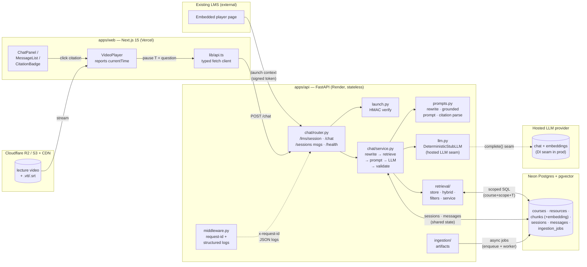

# Architecture — AI Learning Assistant MVP

## Component diagram

Embed direction: `apps/web` ships as a page **or** an embeddable widget inside an LMS page; the backend is a standalone sidecar — never an in-LMS-process plugin (ADR-001).

## Request data flow

`Player pause (T) → POST /chat {session_id, current_time_ms=T, message, mode} → load session (course_id + resource_scope) → coreference rewrite (last ≤5 user turns) → hybrid retrieval (BM25 + pgvector → RRF → cross-encoder rerank top-20 → top-5–8) with SQL scope filter → post-retrieval assertion gate → grounded prompt (evidence as untrusted <context>) → LLM → citation validation (every [chunk_id=…] ∈ retrieved set, else refuse) → {answer, citations[], refused}`.

Session creation precedes it: `LMS launch → POST /lms/session (verify HMAC + freshness) → opaque session_id → subsequent /chat calls carry session_id + fresh T per question`.

## LMS boundary fields

Per request (or at session creation) the LMS supplies — `learner_id` (opaque; verified via HMAC-signed launch/LTI-style token), `course_id`, `resource_id`, `lesson_id`, `resource_scope`/permissions, `current_time_ms`, optional `session_id`. Client-supplied identity claims are never trusted without a signed token; permissions resolve server-side from the stored session scope (`IMPLEMENTATION_PLAN.md` §1, ADR-001 §Decision-2).

Canonical signed payload (newline-joined, scope sorted, empty lesson as `""`): `learner_id\ncourse_id\nresource_id\nlesson_id\nscope_csv\ncurrent_time_ms\nissued_at`; `signature = hex(HMAC-SHA256(lms_launch_secret, canonical))`; freshness `≤15min` age, `≤5min` future skew (`app/chat/launch.py`).

## Timestamp-gate statement (end_ms rule)

Video/video_transcript chunks are retrievable **iff `end_ms IS NOT NULL AND end_ms <= T`** — the gate is on `end_ms`, not `start_ms`, so a chunk overlapping the pause point (`start_ms <= T < end_ms`) is excluded and `end_ms == T` is kept; NULL-`end_ms` video chunks are excluded defensively and logged. Enforced twice: SQL `WHERE` in the store layer + `assert_no_leakage()` post-retrieval assertion (`app/retrieval/filters.py`) that also drops out-of-scope `resource_id`s before fusion/rerank/prompt assembly. PDF/PPT/note/code chunks ignore T. `summarize`/`quiz` modes additionally filter all source types to `start_ms <= T`. Rationale: the eval harness measured a 0.48 production-gap leakage rate under the looser `start_ms` rule with no recall loss under the strict rule (`IMPLEMENTATION_PLAN.md` §6; `docs/eval-results/baseline-strict.json`). Never rely on the prompt for this — deterministic code owns the boundary.

## Prototype vs scale-out split

| Concern | Prototype (MVP demo) | Scale-out (gated on measured load) |
|---|---|---|
| API | 1 Render instance (`apps/api/Dockerfile`) | N stateless replicas + LB (no code change — no in-memory learner state; session/message stores move to SQLAlchemy repos behind same method names) |
| DB | 1 Neon Postgres + pgvector (relational + HNSW + JSONB in one box) | + PgBouncer/pool tuning, read replicas for history reads |
| Ingestion | BG thread/process + `ingestion_jobs` table; API only enqueues | Dedicated worker service |
| Retrieval | Postgres FTS + pgvector → RRF → rerank | + short-TTL cache keyed `(resource_id, T bucket, query-hash)`; swap `VectorStore` impl to Qdrant/OpenSearch only when measured p95/CPU justifies |
| Frontend | Vercel hobby, single project | Same; edge cache + preview envs |

Scale-out triggers (all measured, none asserted — `IMPLEMENTATION_PLAN.md` §14, ADR-001 §Scaling Boundary): sustained chat p95 over demo budget under k6/Locust at 25/50/100 concurrent learners; SQLAlchemy pool exhaustion; vector-search CPU saturation as chunks grow 1k→50k; API p95 degradation while a full-course ingestion runs. Each scale-out addition is recorded in an ADR update.
