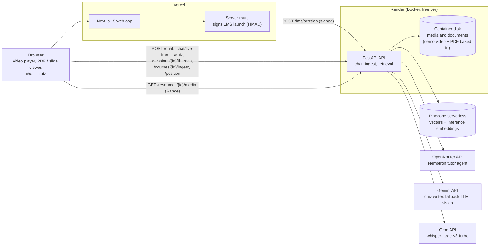
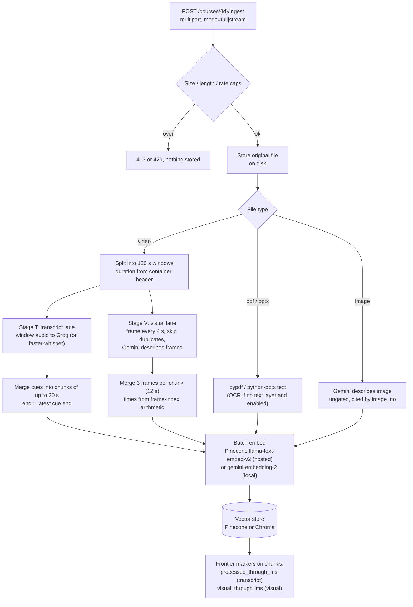
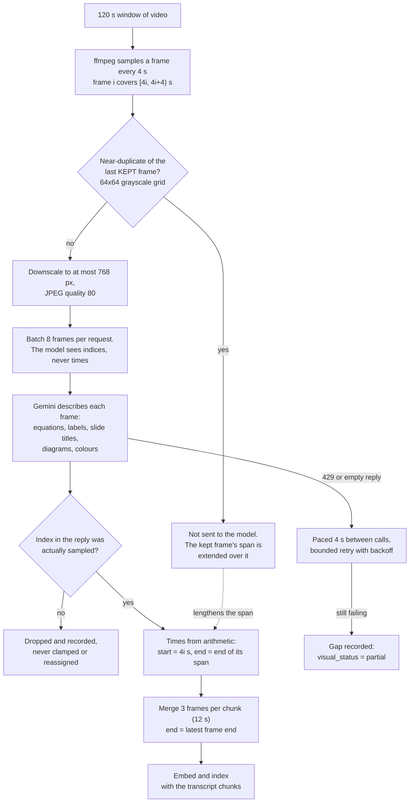
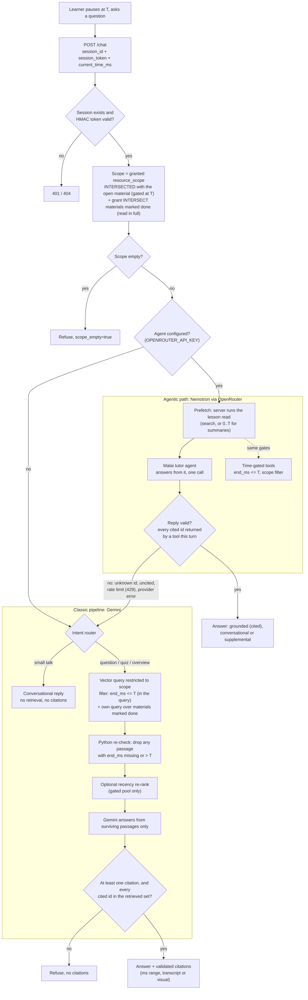
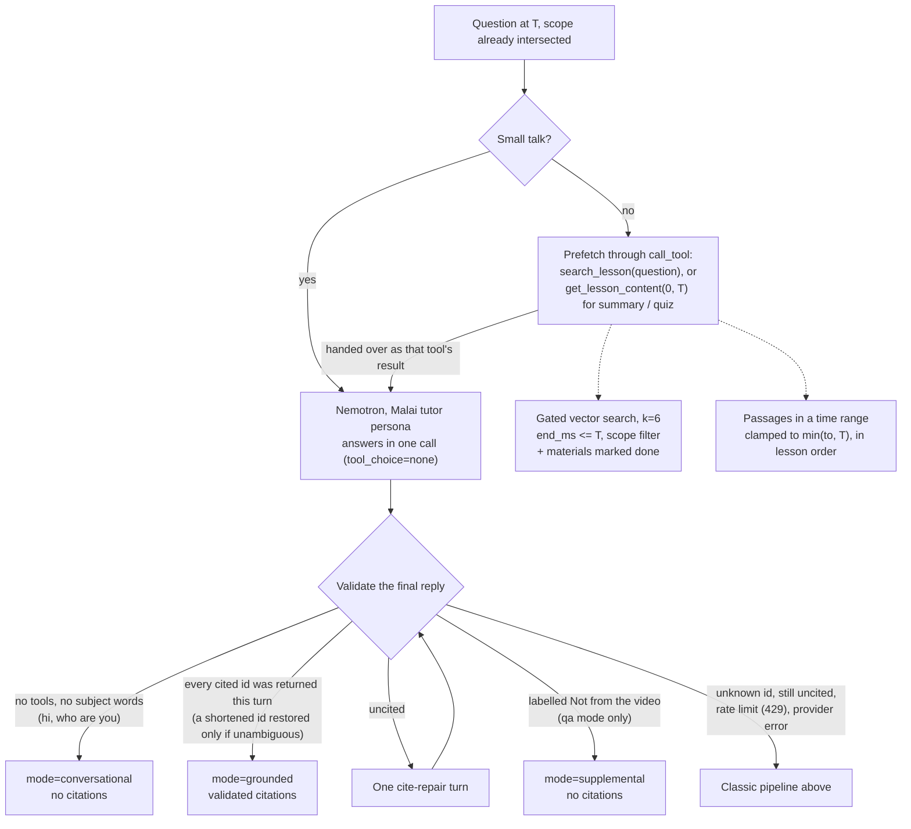
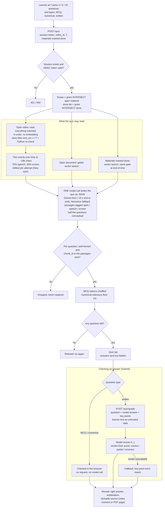
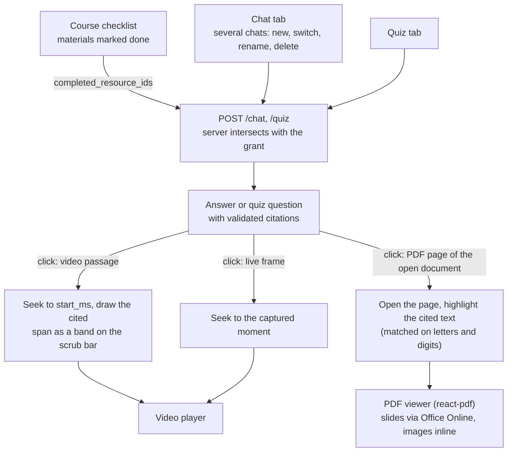

# Architecture

Malai Pioneer has two deployable parts: a Next.js web app and a FastAPI API.
The API makes every decision that matters for correctness: which passages a
learner may see at time `T`, which citations are real, and when to refuse. The
browser plays media, captures a frame when asked, and posts requests.

Related: [API.md](API.md) (routes), [DEPLOYMENT.md](DEPLOYMENT.md)
(how to stand this up).

PNG versions of every diagram on this page are in [diagrams/](diagrams/):

| Diagram | PNG |
|---|---|
| System overview | [0-system-overview.png](diagrams/0-system-overview.png) |
| (a) Hosting topology | [1-hosting-topology.png](diagrams/1-hosting-topology.png) |
| (b) Ingest pipeline | [2-ingest-pipeline.png](diagrams/2-ingest-pipeline.png) |
| Inside the visual lane | [5-visual-lane.png](diagrams/5-visual-lane.png) |
| (c) Question flow, agentic and classic | [3-question-flow.png](diagrams/3-question-flow.png) |
| Inside the agentic tutor | [4-agentic-tutor.png](diagrams/4-agentic-tutor.png) |
| (d) Practice quizzes | [6-practice-quiz.png](diagrams/6-practice-quiz.png) |
| (e) Lesson page: viewers, cited passages, chats | [7-lesson-page.png](diagrams/7-lesson-page.png) |

## (a) Hosting topology

| Component | Where | Why there |
|---|---|---|
| Web (Next.js 15) | Vercel, root dir `apps/web` | Static and edge-friendly. The only server-side code is the launch-signing route, which keeps `LMS_LAUNCH_SECRET` out of the browser |
| API (FastAPI) | Render web service, Docker, free tier (`render.yaml`, `apps/api/deploy/render/Dockerfile`) | Vercel cannot host it: the function bundle limit is 250 MB, while faster-whisper, PyAV and chromadb are larger, and ingest jobs run in the background for minutes. One process, because jobs and sessions live in memory |
| Vectors | Pinecone serverless (`VECTOR_STORE=pinecone`) | Render's free disk is wiped on restart, so the index lives outside the container. The same `build_where` scope + strict-T filter runs in Pinecone, and every match is re-checked against it in Python. Local dev uses Chroma on disk (`VECTOR_STORE=chroma`) |
| Files | Container disk | A hackathon trade-off. The demo video and the UNIT-1 PDF notes are baked into the image, so they are always there. Files uploaded on the hosted site last until the next restart. The media route serves them with HTTP Range |
| Tutor agent | OpenRouter, `nvidia/nemotron-3.5-super-vl:free` | Free, reliable tool calling with a 1M context. Optional: with no `OPENROUTER_API_KEY`, the classic pipeline answers every question |
| LLM / vision | Gemini `gemini-3.5-flash-lite` | Quiz writing (about 15 s for a whole quiz), fallback answers and frame descriptions. Blocking SDK calls run on a worker thread, so a slow answer never stalls other requests |
| Embeddings | Pinecone Inference `llama-text-embed-v2` (1024-d) hosted; Gemini `gemini-embedding-2` (3072-d) locally | Pinecone's free plan meters 5M tokens a month, not Gemini's ~1,000 texts a day. The store refuses to start if the index width and the embedder disagree |
| Speech to text | Groq `whisper-large-v3-turbo`, with local faster-whisper as fallback | About 3 s per 2-minute window on Groq, against 14-18 s for local `tiny` (measured, see [EVALUATION.md](EVALUATION.md)). This is what makes a small CPU host workable |

Free-tier protection on the API: `MAX_UPLOAD_MB`, `MAX_VIDEO_MINUTES` (read from
the container header before any model call), `MAX_UPLOADS_PER_HOUR`, a
60 requests/min/IP limit on chat routes, and fail-fast quota handling. A spent
daily quota returns `503 {"detail": "... quota reached ..."}` and does not keep
retrying.

## (b) Ingest pipeline

How it works:

- **Windows.** Video is processed in 120 s windows. Each window has two
  independently committed stages. Stage T (transcribe, chunk, embed, store) runs
  first, so a window becomes askable quickly. Stage V (frame descriptions) runs
  in a second lane in parallel, one window behind.
- **Modes.** `full` processes every window in one job. `stream` processes the
  first window (2 minutes) at upload. After that the player reports its
  position (`POST /courses/{id}/resources/{rid}/position`), and the API queues up
  to two transcript windows ahead of the playhead plus a visual catch-up job.
- **Frontiers live in the store, not in memory.** Chunks carry
  `processed_through_ms` and `visual_through_ms`, so the next window can be
  derived after a restart. A window with nothing to index still advances the
  frontier.
- **Timestamps never come from a language model.** Transcript times come from
  the ASR segments, shifted by the window offset. Frame times come from the
  sampler's index. A frame index in the model's reply that the sampler never
  produced is dropped and recorded; it is never clamped or reassigned.
- **Degradation is reported.** Each job reports `visual_status`
  (complete / partial / failed / skipped), `visual_coverage_pct` and warnings. A
  scanned PDF that could not be read reports `skipped` or `failed` with the reason.
  It never looks like an empty document that was read successfully.

### Inside the visual lane

Frames are not transcribed. Gemini's vision model *describes* each one in
text, and that text is indexed like the transcript
(`apps/api/app/ingestion/visual.py`).

- **Cost:** a 655 s lecture samples 164 frames. That's 21 requests before
  duplicates are skipped. Calls start at least 4 s apart, with up to 3 in
  flight, to stay under the free tier's ~15 requests a minute.
- **Strict timestamps:** a frame's time comes from its index, so a description
  is gated exactly like a transcript passage. A merged chunk ends at its latest
  frame, so it becomes answerable only after every frame in it has played.
- **Live frames:** when a learner asks "what's on screen?", the player sends
  the paused frame itself. It's described on the spot as a passage at exactly
  T and never indexed.

## (c) Question flow

Every question passes the same session and scope checks. Then the **agentic
tutor** answers first. The **classic pipeline** answers when the agent is not
configured, or when its reply fails validation. Both paths read the lesson only
through the strict-T gate.

### Inside the agentic tutor

The agent is `app/chat/agent.py`, and its tool loop works like this:

- **The model chooses tools; code chooses what it sees.** Both tools run through
  the same scope and strict-T gate as the classic path. A request for
  `get_lesson_content(0, 99999)` returns only what has played.
- **Repairs before falling back.** An answer that cites nothing gets one
  cite-repair turn. A citation the model shortened (`c3_83fd4ed4` for
  `res_…_c3_83fd4ed4`) is restored only when exactly one passage returned this
  turn ends with it; anything else is an unknown id and falls back. Only after
  that does the classic pipeline take over.
- **Prefetch, then one call.** The server runs the read the model would ask
  for first (`search_lesson` for a question, `get_lesson_content(0, T)` for a
  summary or quiz) through the same gates, and hands it over as that tool's
  result. The model then answers in one call, which on the free endpoint is
  the difference between one slow round trip and four.
- **Budgets.** At most 2 model calls (the answer, plus one cite-repair turn),
  and no time limit of our own: a slow free-tier reply is waited for
  (`AGENT_TIMEOUT_S` / `AGENT_TOTAL_TIMEOUT_S` bring one back). A reply cut off at the token limit has any unfinished
  `[chunk_id=...` removed and asks the learner to say "continue".
- **Without the agent**, a regex intent router (`app/chat/intent.py`) keeps
  the classic path from going wrong:
  - Small talk gets a short conversational reply with no retrieval.
  - "What questions can the prof ask?" becomes quiz mode.
  - "What have we covered?" becomes summarize mode, over a coverage query.

"Ask about this frame" (`POST /chat/live-frame`) adds one step before the query.
The captured JPEG is described by Gemini, and the description joins the pool as a
passage with `start_ms == end_ms == T`, so it passes the same gate. `T` is first
checked against the duration the server read from the file. An out-of-range `T`
gets `422`; it is never clamped.

## (d) Practice quizzes

The **Quiz** tab beside the chat writes a real quiz: multiple choice,
numerical and written questions. It reads the lesson through the same gates as
chat. The whole quiz costs **one** model call. Multiple-choice and numerical
answers are checked in the browser with no model call; only written answers
go back to the model for grading.

- **Same gates as chat.** The quiz never sees past the playhead, never reads a
  material outside the grant, and a material counts as readable in full only
  when the learner marked it done.
- **Every question is cited.** A question whose `chunk_id` was not among the
  passages sent is dropped, so the source link on each answer is always real.
- **Why the in-order read.** A similarity search for "key concepts, formulas"
  matched mostly on-screen frame descriptions, so quizzes ignored what the
  lecturer said. Reading the watched range in order and balancing speech
  against screen keeps theory questions in the mix.

## (e) Lesson page: viewers, cited passages, chats

The lesson page shows the open material beside the tutor. Clicking a citation
shows exactly what it cites.

- **Several chats per session.** Each chat (`thread_id`) has its own history;
  the original one is `main`. The chat service itself is unaware of chats: the
  router sets the current chat per request and the message store keys history by
  it.
- **Open material plus what is marked done.** A chat reads the open material up
  to the playhead, plus every material ticked done in the course checklist (read
  in full), and nothing else from the course. The done list is intersected with
  the session grant, so it can never reach a material the session was not given.
- **Cited passages.** Each citation carries the passage text. The PDF viewer
  finds it on the cited page by comparing letters and digits only, so line
  breaks, hyphenation and ligatures do not stop the match (93 of the UNIT-1
  PDF's 97 chunks match in full, the rest partly, none missed).

## Safety invariants

These are product properties, and the tests pin them. They are not tuning
knobs.

| # | Invariant | Why |
|---|---|---|
| 1 | **Strict timestamp gate: keep a video passage only when `end_ms <= T`.** Never `start_ms <= T`. A missing `end_ms` excludes the passage. The rule is enforced inside the vector query and re-checked in Python. | A passage that *starts* before `T` can still *end* after it, and its tail is a spoiler. An earlier eval with the loose rule measured a 48% production-gap rate. The current eval measures 0 leakage. |
| 2 | **Citations are validated against the retrieved set.** Uncited answers and unknown ids are refused. | A model can cite a plausible-looking id that was never retrieved. Passing that through presents an ungrounded answer as grounded. |
| 3 | **Scope is intersected, never replaced.** The focused video narrows the granted `resource_scope`; it cannot widen it. Materials marked done are intersected with the grant the same way, and a quiz question citing anything outside the passages sent is dropped. | An earlier version replaced the scope with the focused id, which let a client read outside its grant. |
| 4 | **Plausible-looking ids are not real ids.** Subjects refuse to attach a resource id that the index cannot vouch for. | A scope such as `["res_video"]` once matched no indexed chunk and silently refused every question. |
| 5 | **Timestamps come from signals, not from the model.** ASR segment times and frame-index arithmetic set the times; a live frame sits at exactly `T`. | A model that labels a frame from 650 s as "index 5" would otherwise store it at 20 s, which is a spoiler leak. |
| 6 | **Signed launches in production.** `LMS_LAUNCH_SECRET=dev-secret` with `ALLOW_UNSIGNED_LAUNCH=true` is for a localhost demo only. Hosted, the Vercel server route signs launches and the API runs with `ALLOW_UNSIGNED_LAUNCH=false`. | The launch carries the learner, the course and the allowed resources. Unsigned, anyone could grant themselves any scope. |
| 7 | **Secrets stay out of the repo and the browser.** `apps/api/.env` is git-ignored. The web app's launch secret is server-only (no `NEXT_PUBLIC_` prefix). | |
| 8 | **Model HTML stays inert.** No `rehype-raw`, and KaTeX runs with `trust: false`. `npm run contract-check` fails if either is broken. | Answers are model output rendered in the learner's browser. |
