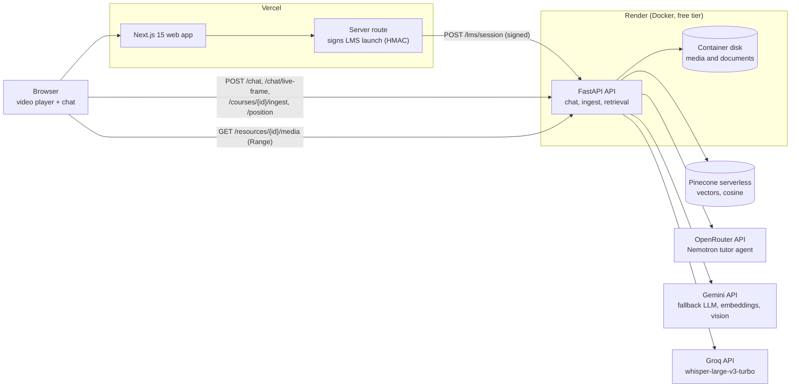
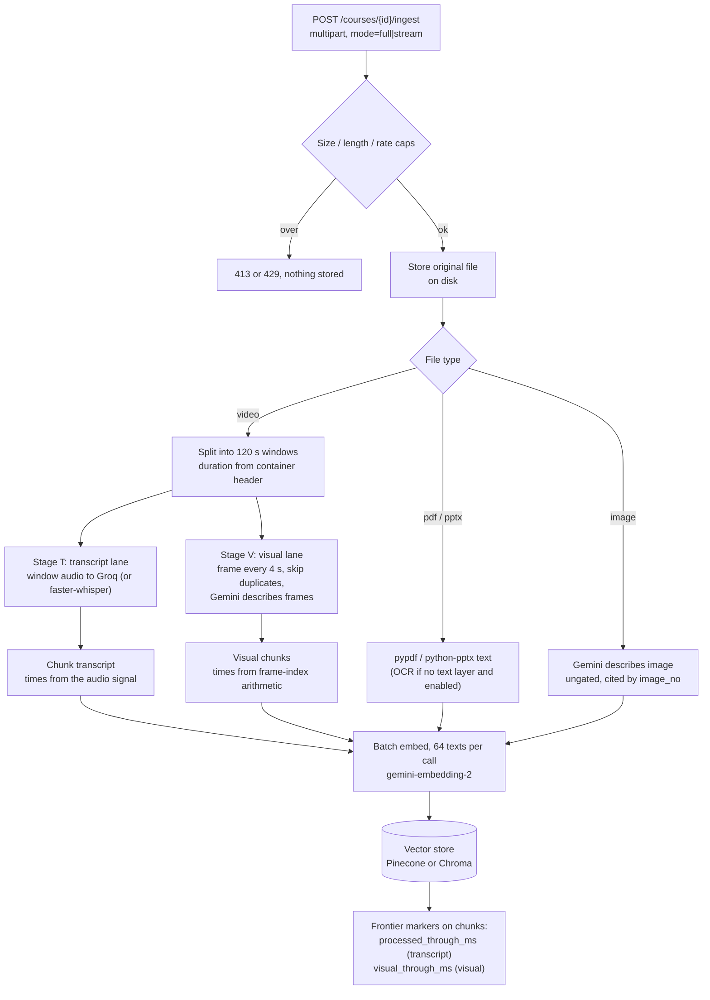
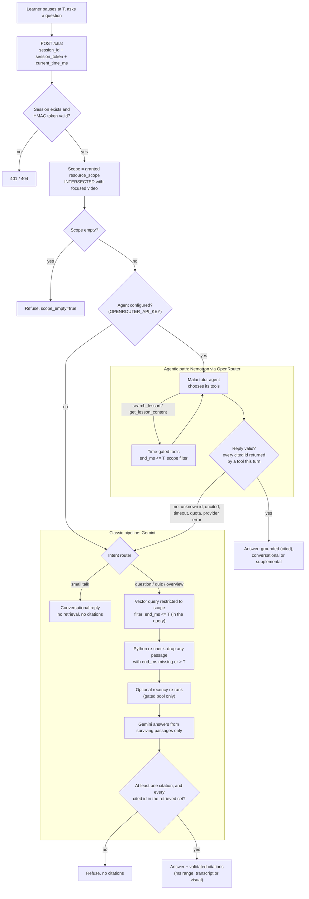
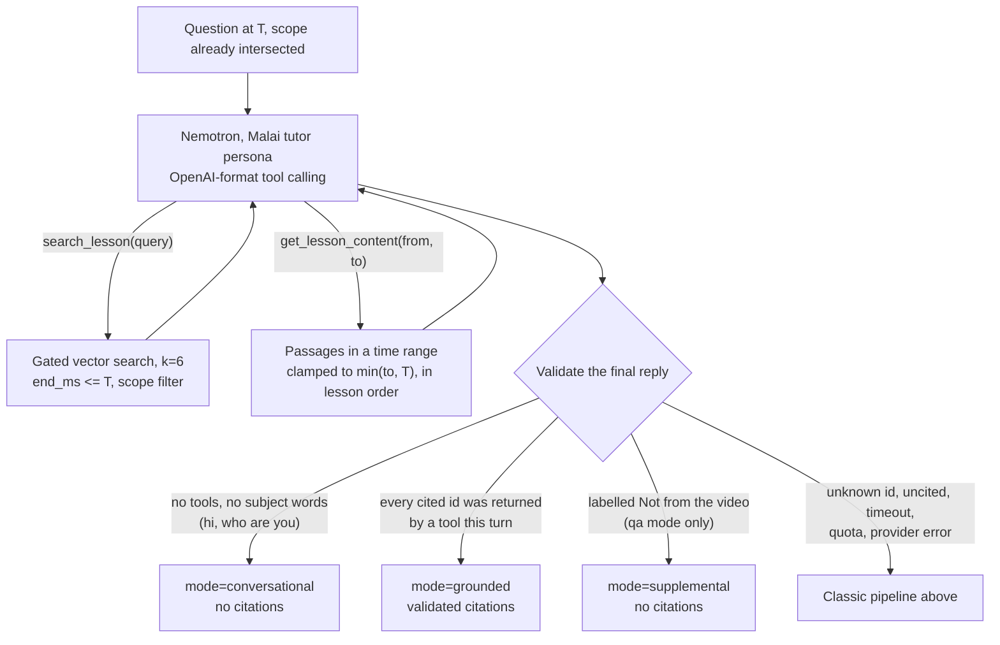

# Architecture

Malai Pioneer has two deployable parts: a Next.js web app and a FastAPI API.
The API makes every decision that matters for correctness: which passages a
learner may see at time `T`, which citations are real, and when to refuse. The
browser plays media, captures a frame when asked, and posts requests.

Related: [API.md](API.md) (routes), [DEPLOYMENT.md](DEPLOYMENT.md)
(how to stand this up).

PNG versions of every diagram on this page are in [diagrams/](diagrams/):

| Diagram | PNG |
|---|---|
| System overview | [0-system-overview.png](diagrams/0-system-overview.png) |
| (a) Hosting topology | [1-hosting-topology.png](diagrams/1-hosting-topology.png) |
| (b) Ingest pipeline | [2-ingest-pipeline.png](diagrams/2-ingest-pipeline.png) |
| (c) Question flow, agentic and classic | [3-question-flow.png](diagrams/3-question-flow.png) |
| Inside the agentic tutor | [4-agentic-tutor.png](diagrams/4-agentic-tutor.png) |

## (a) Hosting topology

| Component | Where | Why there |
|---|---|---|
| Web (Next.js 15) | Vercel, root dir `apps/web` | Static and edge-friendly. The only server-side code is the launch-signing route, which keeps `LMS_LAUNCH_SECRET` out of the browser |
| API (FastAPI) | Render web service, Docker, free tier (`render.yaml`, `apps/api/deploy/render/Dockerfile`) | Vercel cannot host it: the function bundle limit is 250 MB, while faster-whisper, PyAV and chromadb are larger, and ingest jobs run in the background for minutes. One process, because jobs and sessions live in memory |
| Vectors | Pinecone serverless (`VECTOR_STORE=pinecone`) | Render's free disk is wiped on restart, so the index lives outside the container. The same `build_where` scope + strict-T filter runs in Pinecone, and every match is re-checked against it in Python. Local dev uses Chroma on disk (`VECTOR_STORE=chroma`) |
| Files | Container disk | A hackathon trade-off. The demo video is baked into the image, so it is always there. Files uploaded on the hosted site last until the next restart. The media route serves them with HTTP Range |
| Tutor agent | OpenRouter, `nvidia/nemotron-3.5-super-vl:free` | Free, reliable tool calling with a 1M context. Optional: with no `OPENROUTER_API_KEY`, the classic pipeline answers every question |
| LLM / embeddings / vision | Gemini `gemini-3.5-flash-lite`, `gemini-embedding-2` (3072-d) | One provider for fallback answers, vectors and frame descriptions |
| Speech to text | Groq `whisper-large-v3-turbo`, with local faster-whisper as fallback | About 3 s per 2-minute window on Groq, against 14-18 s for local `tiny` (measured, see [EVALUATION.md](EVALUATION.md)). This is what makes a small CPU host workable |

Free-tier protection on the API: `MAX_UPLOAD_MB`, `MAX_VIDEO_MINUTES` (read from
the container header before any model call), `MAX_UPLOADS_PER_HOUR`, a
60 requests/min/IP limit on chat routes, and fail-fast quota handling. A spent
daily quota returns `503 {"detail": "... quota reached ..."}` and does not keep
retrying.

## (b) Ingest pipeline

How it works:

- **Windows.** Video is processed in 120 s windows. Each window has two
  independently committed stages. Stage T (transcribe, chunk, embed, store) runs
  first, so a window becomes askable quickly. Stage V (frame descriptions) runs
  in a second lane in parallel, one window behind.
- **Modes.** `full` processes every window in one job. `stream` processes the
  first 3 windows (6 minutes) at upload. After that the player reports its
  position (`POST /courses/{id}/resources/{rid}/position`), and the API queues up
  to two transcript windows ahead of the playhead plus a visual catch-up job.
- **Frontiers live in the store, not in memory.** Chunks carry
  `processed_through_ms` and `visual_through_ms`, so the next window can be
  derived after a restart. A window with nothing to index still advances the
  frontier.
- **Timestamps never come from a language model.** Transcript times come from
  the ASR segments, shifted by the window offset. Frame times come from the
  sampler's index. A frame index in the model's reply that the sampler never
  produced is dropped and recorded; it is never clamped or reassigned.
- **Degradation is reported.** Each job reports `visual_status`
  (complete / partial / failed / skipped), `visual_coverage_pct` and warnings. A
  scanned PDF that could not be read reports `skipped` or `failed` with the reason.
  It never looks like an empty document that was read successfully.

## (c) Question flow

Every question passes the same session and scope checks. Then the **agentic
tutor** answers first. The **classic pipeline** answers when the agent is not
configured, or when its reply fails validation. Both paths read the lesson only
through the strict-T gate.

### Inside the agentic tutor

The agent is `app/chat/agent.py`, and its tool loop works like this:

- **The model chooses tools; code chooses what it sees.** Both tools run through
  the same scope and strict-T gate as the classic path. A request for
  `get_lesson_content(0, 99999)` returns only what has played.
- **Repairs before falling back.** If the model answers a subject question
  without calling a tool, it gets one retry with `tool_choice="required"`. If it
  used tools but cited nothing, it gets one cite-repair turn. Only after that
  does the classic pipeline take over.
- **Budgets.** At most 4 tool steps, 30 s per provider call and 60 s for the
  whole loop. A reply cut off at the token limit has any unfinished
  `[chunk_id=...` removed and asks the learner to say "continue".
- **Without the agent**, a regex intent router (`app/chat/intent.py`) keeps
  the classic path from going wrong:
  - Small talk gets a short conversational reply with no retrieval.
  - "What questions can the prof ask?" becomes quiz mode.
  - "What have we covered?" becomes summarize mode, over a coverage query.

"Ask about this frame" (`POST /chat/live-frame`) adds one step before the query.
The captured JPEG is described by Gemini, and the description joins the pool as a
passage with `start_ms == end_ms == T`, so it passes the same gate. `T` is first
checked against the duration the server read from the file. An out-of-range `T`
gets `422`; it is never clamped.

## Safety invariants

These are product properties, and the tests pin them. They are not tuning
knobs.

| # | Invariant | Why |
|---|---|---|
| 1 | **Strict timestamp gate: keep a video passage only when `end_ms <= T`.** Never `start_ms <= T`. A missing `end_ms` excludes the passage. The rule is enforced inside the vector query and re-checked in Python. | A passage that *starts* before `T` can still *end* after it, and its tail is a spoiler. An earlier eval with the loose rule measured a 48% production-gap rate. The current eval measures 0 leakage. |
| 2 | **Citations are validated against the retrieved set.** Uncited answers and unknown ids are refused. | A model can cite a plausible-looking id that was never retrieved. Passing that through presents an ungrounded answer as grounded. |
| 3 | **Scope is intersected, never replaced.** The focused video narrows the granted `resource_scope`; it cannot widen it. | An earlier version replaced the scope with the focused id, which let a client read outside its grant. |
| 4 | **Plausible-looking ids are not real ids.** Subjects refuse to attach a resource id that the index cannot vouch for. | A scope such as `["res_video"]` once matched no indexed chunk and silently refused every question. |
| 5 | **Timestamps come from signals, not from the model.** ASR segment times and frame-index arithmetic set the times; a live frame sits at exactly `T`. | A model that labels a frame from 650 s as "index 5" would otherwise store it at 20 s, which is a spoiler leak. |
| 6 | **Signed launches in production.** `LMS_LAUNCH_SECRET=dev-secret` with `ALLOW_UNSIGNED_LAUNCH=true` is for a localhost demo only. Hosted, the Vercel server route signs launches and the API runs with `ALLOW_UNSIGNED_LAUNCH=false`. | The launch carries the learner, the course and the allowed resources. Unsigned, anyone could grant themselves any scope. |
| 7 | **Secrets stay out of the repo and the browser.** `apps/api/.env` is git-ignored. The web app's launch secret is server-only (no `NEXT_PUBLIC_` prefix). | |
| 8 | **Model HTML stays inert.** No `rehype-raw`, and KaTeX runs with `trust: false`. `npm run contract-check` fails if either is broken. | Answers are model output rendered in the learner's browser. |
