# Architecture

Malai Pioneer has two deployable parts: a Next.js web app and a FastAPI API.
The API makes every decision that matters for correctness: which passages a
learner may see at time `T`, which citations are real, and when to refuse. The
browser plays media, captures a frame when asked, and posts requests.

Related: [API.md](API.md) (routes), [DEPLOYMENT.md](DEPLOYMENT.md)
(how to stand this up).

PNG versions of every diagram on this page are in [diagrams/](diagrams/), and
their Mermaid sources are in [diagrams/src/](diagrams/src/):

| Diagram | PNG |
|---|---|
| System overview | [0-system-overview.png](diagrams/0-system-overview.png) |
| The RAG pipeline at a glance | [9-rag-pipeline.png](diagrams/9-rag-pipeline.png) |
| (a) Hosting topology | [1-hosting-topology.png](diagrams/1-hosting-topology.png) |
| (b) Ingest pipeline | [2-ingest-pipeline.png](diagrams/2-ingest-pipeline.png) |
| Inside the visual lane | [5-visual-lane.png](diagrams/5-visual-lane.png) |
| (c) Question flow, agentic and classic | [3-question-flow.png](diagrams/3-question-flow.png) |
| Inside the agentic tutor | [4-agentic-tutor.png](diagrams/4-agentic-tutor.png) |
| (d) Practice quizzes | [6-practice-quiz.png](diagrams/6-practice-quiz.png) |
| (e) Lesson page: viewers, cited passages, chats | [7-lesson-page.png](diagrams/7-lesson-page.png) |
| (f) Developer view: the live pipeline trace | [8-developer-view.png](diagrams/8-developer-view.png) |
| (g) Accounts, saved state and file storage | [10-accounts-storage.mmd](diagrams/src/10-accounts-storage.mmd) (Mermaid source; renders on GitHub below) |
| (h) Voice conversations | [11-voice.mmd](diagrams/src/11-voice.mmd) (Mermaid source; renders on GitHub below) |

**How to read the diagrams.** Every diagram uses the same colours:

| Colour | Means |
|---|---|
| Blue | The learner or teacher, and what they see in the browser |
| Purple | Our server doing the work |
| Amber | An outside AI service (Groq, Gemini, Gemini Live, Nemotron, embeddings) |
| Green cylinder | Where something is stored (search index, files, database) |
| Red outline | A safety check: a decision that can stop or reject something |
| Green box | A good outcome the learner receives |
| Red box | A refusal or a rejected item |

The boxes describe each step in plain words. The text under each diagram gives
the technical detail.

## System overview

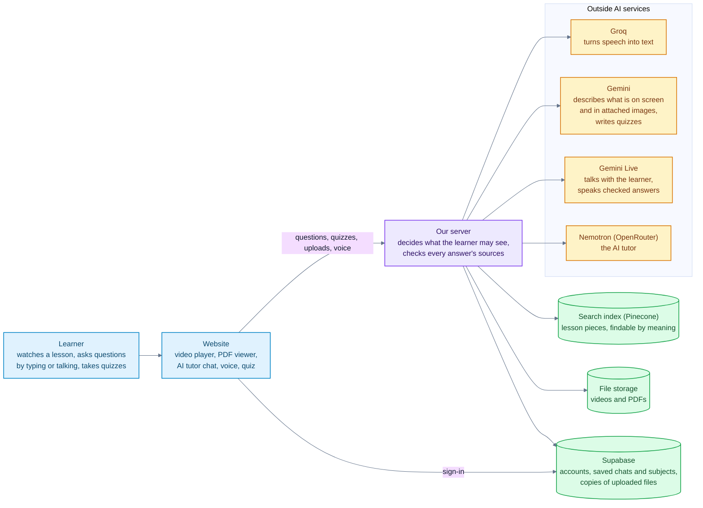

The learner only ever talks to our server, through the website (sign-in goes
to Supabase directly, and the token it returns is checked by our server). The server
decides what the learner may see at the moment they paused, calls the AI
services, and checks every answer's sources before showing it. The AI services
never decide what is allowed; they only write text from what the server gives
them.

## The RAG pipeline at a glance

Malai Pioneer is a retrieval-augmented generation (RAG) system. No model is
trained or fine-tuned on the course. The lesson files are indexed once, and for
every question the relevant pieces are retrieved and handed to the model, which
may answer only from them.

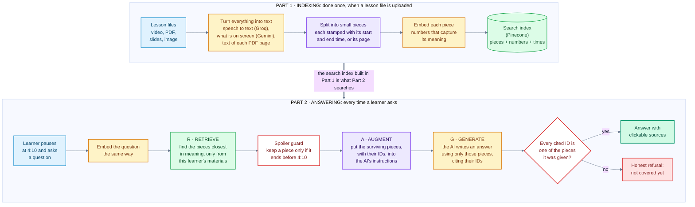

- **Part 1, indexing**, is section (b) below: speech is transcribed by Groq,
  frames are described by Gemini, PDF text is read, and everything is cut into
  timestamped pieces and embedded (`llama-text-embed-v2` on Pinecone when
  hosted).
- **R, retrieve.** The question is embedded the same way, and a vector search
  finds the closest pieces within the learner's own materials. The **spoiler
  guard** (`end_ms <= T`) is not a separate pass in practice: it is part of the
  search filter itself, and every piece returned is checked again in Python. It
  is drawn as its own step because it is the rule that matters most.
- **A, augment.** The surviving pieces go into the prompt with their IDs and
  times, as the only material the model may use.
- **G, generate.** The model (Nemotron through OpenRouter, or Gemini) writes the
  answer and cites piece IDs. Any ID it was not given, or an answer with no
  citations, means a refusal instead of an answer.
- Section (c) shows the full question flow, including the agentic tutor, which
  runs the same retrieve step through its tools.

## (a) Hosting topology

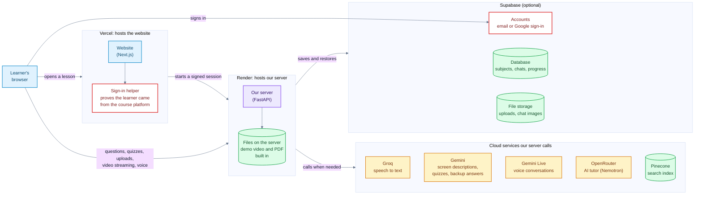

| Component | Where | Why there |
|---|---|---|
| Web (Next.js 15) | Vercel, root dir `apps/web` | Static and edge-friendly. The server-side code is the launch-signing route, which keeps `LMS_LAUNCH_SECRET` out of the browser, plus the Supabase sign-in callback and the middleware that sends signed-out visitors to `/login` |
| API (FastAPI) | Render web service, Docker, free tier (`render.yaml`, `apps/api/deploy/render/Dockerfile`) | Vercel cannot host it: the function bundle limit is 250 MB, while faster-whisper, PyAV and chromadb are larger, and ingest jobs run in the background for minutes. One process, because ingest jobs live in memory and voice sessions are relayed through it |
| Vectors | Pinecone serverless (`VECTOR_STORE=pinecone`) | Render's free disk is wiped on restart, so the index lives outside the container. The same `build_where` scope + strict-T filter runs in Pinecone, and every match is re-checked against it in Python. Local dev uses Chroma on disk (`VECTOR_STORE=chroma`) |
| Files | Container disk | A hackathon trade-off. The demo video and the UNIT-1 PDF notes are baked into the image, so they are always there, together with their chapters (`apps/api/deploy/seed/chapters/` → `data/chapters/`) and the demo subject. Without Supabase, files uploaded on the hosted site, and their chapters, last until the next restart. With it, each upload is also copied to Storage and downloaded back when the local copy is missing. The media route serves them with HTTP Range |
| Accounts, database, Storage | Supabase (optional: on when `SUPABASE_URL` and the service key are set) | Sign-in, and state that must outlive Render's ephemeral disk: subjects, sessions, chats, the Malai chat list, chat images, study activity, progress and quiz attempts. Row-level security on every table; the API uses the service key, the browser only the public key. Migrations in `supabase/migrations/` |
| Voice | Gemini Live, relayed by the API over WebSockets | The Gemini key stays on the server, and the API can route every spoken course question through the checked pipeline |
| Tutor agent | OpenRouter, `nvidia/nemotron-3.5-super-vl:free` | Free, reliable tool calling with a 1M context. Optional: with no `OPENROUTER_API_KEY`, the classic pipeline answers every question |
| LLM / vision | Gemini `gemini-3.5-flash-lite` | Quiz writing (about 15 s for a whole quiz), fallback answers and frame descriptions. Blocking SDK calls run on a worker thread, so a slow answer never stalls other requests |
| Embeddings | Pinecone Inference `llama-text-embed-v2` (1024-d) hosted; Gemini `gemini-embedding-2` (3072-d) locally | Pinecone's free plan meters 5M tokens a month, not Gemini's ~1,000 texts a day. The store refuses to start if the index width and the embedder disagree |
| Speech to text | Groq `whisper-large-v3-turbo`, with local faster-whisper as fallback | About 3 s per 2-minute window on Groq, against 14-18 s for local `tiny` (measured, see [EVALUATION.md](EVALUATION.md)). This is what makes a small CPU host workable |

Free-tier protection on the API: `MAX_UPLOAD_MB`, `MAX_VIDEO_MINUTES` (read from
the container header before any model call), `MAX_UPLOADS_PER_HOUR`, a
60 requests/min/IP limit on chat routes, and fail-fast quota handling. A spent
daily quota returns `503 {"detail": "... quota reached ..."}` and does not keep
retrying.

## (b) Ingest pipeline

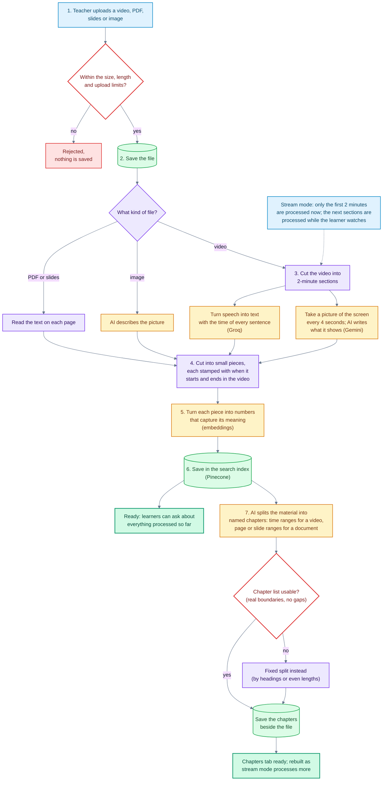

How it works:

- **Windows.** Video is processed in 120 s windows. Each window has two
  independently committed stages. Stage T (transcribe, chunk, embed, store) runs
  first, so a window becomes askable quickly. Stage V (frame descriptions) runs
  in a second lane in parallel, one window behind.
- **Modes.** `full` processes every window in one job. `stream` processes the
  first window (2 minutes) at upload. After that the player reports its
  position (`POST /courses/{id}/resources/{rid}/position`), and the API queues up
  to two transcript windows ahead of the playhead plus a visual catch-up job.
- **Frontiers live in the store, not in memory.** Chunks carry
  `processed_through_ms` and `visual_through_ms`, so the next window can be
  derived after a restart. A window with nothing to index still advances the
  frontier.
- **Timestamps never come from a language model.** Transcript times come from
  the ASR segments, shifted by the window offset. Frame times come from the
  sampler's index. A frame index in the model's reply that the sampler never
  produced is dropped and recorded; it is never clamped or reassigned.
- **Degradation is reported.** Each job reports `visual_status`
  (complete / partial / failed / skipped), `visual_coverage_pct` and warnings. A
  scanned PDF that could not be read reports `skipped` or `failed` with the reason.
  It never looks like an empty document that was read successfully.

### Chapters, after ingestion

When an ingest job succeeds, a background task writes chapters for the
resource (`apps/api/app/ingestion/chapters.py`), served at
`GET /resources/{id}/chapters` and shown in the lesson panel's Chapters tab.

- **What a chapter is.** A short topic name over a contiguous span: a time range
  for a video, a page range for a PDF, a slide range for a deck.
- **How.** One model call over a compact, ordered digest of the indexed chunks
  (read by exact `resource_id`). Its JSON is validated: boundaries are snapped
  to real timestamps or pages, sorted, gaps and overlaps repaired, junk titles
  dropped. Unusable output, a failed call or the offline stub falls back to a
  deterministic split, which is still a ready result. A chapter failure never
  fails the ingest.
- **Storage and staleness.** One JSON file per resource in `data/chapters/`
  (`CHAPTERS_DIR` overrides it). A stream-mode video records the frontier it
  was built from and is rebuilt once processing has moved on by more than
  2 minutes, or the video is complete. A missing or stale file is rebuilt in
  the background the next time it is requested; the route never waits for the
  model. Deleting a resource deletes its chapters.
- **Catalogue only.** Chapters never feed retrieval, `build_where`, the strict
  `end_ms <= T` gate or citation validation. A chapter list that names the end
  of a lecture is navigation the learner chose to open, not evidence for an
  answer.
- **Demo seed.** The demo video (3 chapters) and PDF (8 chapters) have their
  chapter files baked into the API image, generated against the same Pinecone
  chunks, so they are ready after every restart with no model calls.

### Inside the visual lane

Frames are not transcribed. Gemini's vision model *describes* each one in
text, and that text is indexed like the transcript
(`apps/api/app/ingestion/visual.py`).

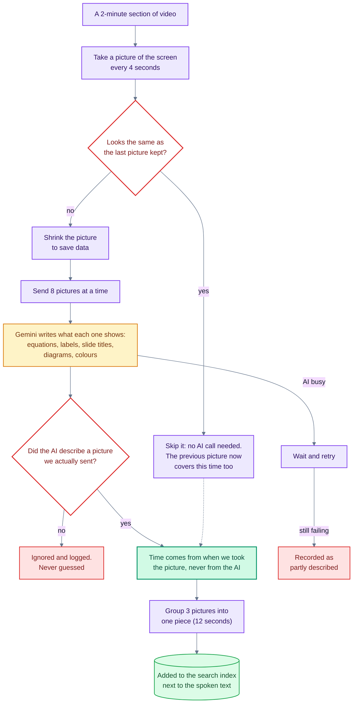

- **Cost:** a 655 s lecture samples 164 frames. That's 21 requests before
  duplicates are skipped. Calls start at least 4 s apart, with up to 3 in
  flight, to stay under the free tier's ~15 requests a minute.
- **Strict timestamps:** a frame's time comes from its index, so a description
  is gated exactly like a transcript passage. A merged chunk ends at its latest
  frame, so it becomes answerable only after every frame in it has played.
- **Live frames:** when a learner asks "what's on screen?", the player sends
  the paused frame itself. It's described on the spot as a passage at exactly
  T and never indexed.

## (c) Question flow

Every question passes the same session and scope checks. Then the **agentic
tutor** answers first. The **classic pipeline** answers when the agent is not
configured, or when its reply fails validation. Both paths read the lesson only
through the strict-T gate.

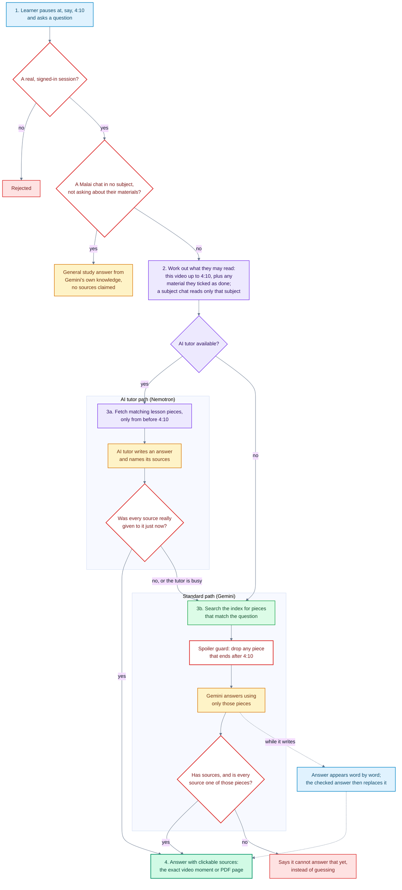

### Inside the agentic tutor

The agent is `app/chat/agent.py`, and its tool loop works like this:

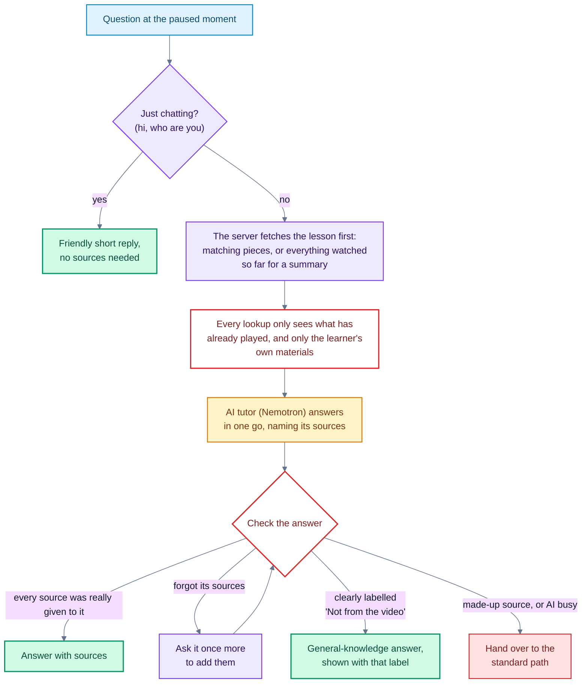

- **The model chooses tools; code chooses what it sees.** Both tools run through
  the same scope and strict-T gate as the classic path. A request for
  `get_lesson_content(0, 99999)` returns only what has played.
- **Repairs before falling back.** An answer that cites nothing gets one
  cite-repair turn. A citation the model shortened (`c3_83fd4ed4` for
  `res_…_c3_83fd4ed4`) is restored only when exactly one passage returned this
  turn ends with it; anything else is an unknown id and falls back. Only after
  that does the classic pipeline take over.
- **Prefetch, then one call.** The server runs the read the model would ask
  for first (`search_lesson` for a question, `get_lesson_content(0, T)` for a
  summary or quiz) through the same gates, and hands it over as that tool's
  result. The model then answers in one call, which on the free endpoint is
  the difference between one slow round trip and four.
- **Budgets.** At most 2 model calls (the answer, plus one cite-repair turn),
  and no time limit of our own: a slow free-tier reply is waited for
  (`AGENT_TIMEOUT_S` / `AGENT_TOTAL_TIMEOUT_S` bring one back). A reply cut off at the token limit has any unfinished
  `[chunk_id=...` removed and asks the learner to say "continue".
- **Without the agent**, a regex intent router (`app/chat/intent.py`) keeps
  the classic path from going wrong:
  - Small talk gets a short conversational reply with no retrieval.
  - "What questions can the prof ask?" becomes quiz mode.
  - "What have we covered?" becomes summarize mode, over a coverage query.

"Ask about this frame" (`POST /chat/live-frame`) adds one step before the query.
The captured JPEG is described by Gemini, and the description joins the pool as a
passage with `start_ms == end_ms == T`, so it passes the same gate. `T` is first
checked against the duration the server read from the file. An out-of-range `T`
gets `422`; it is never clamped.

**Streaming.** `POST /chat/stream` runs exactly the same pipeline as `/chat`
and sends Server-Sent Events while it works (`app/chat/streaming.py`). A sink
bound for that one request receives short status lines ("Searching the
lesson") and the provider's text as it is generated: Gemini streams token by
token, while the agent path shows status lines until its answer is ready.
Citation markers are stripped from the preview, and a marker that has not
closed yet is held back. The preview is written from the already time-gated
passages, so it cannot show anything past `T`. Citation validation still runs
on the finished reply, and the final `done` event carries the validated
answer, which replaces the preview (a refusal replaces it entirely). Outside
this route the sink is unset and every streaming hook does nothing.

**Malai chats: scoped or general.** The `/malai` page holds chats that are not
tied to one open material.

- A chat filed under a subject sends that subject's resources as
  `scope_resource_ids`. They are intersected with the session grant, so they
  can only remove materials. A session with course id `"*"` drops the course
  filter and reads across subjects, still only inside its `resource_scope`.
  With no playhead, such a chat reads documents and the videos marked done.
  The strict `end_ms <= T` gate is unchanged.
- A chat in no subject sends `general: true`. It is answered from general
  knowledge with no retrieval and zero citations (`mode: "general"`), unless
  the message explicitly points at the learner's materials ("my notes", "the
  lecture", "the uploaded pdf"), which takes the ordinary grounded pipeline
  (`tests/test_general_chat.py`).

**Answer style.** Every prompt (grounded, agent and general) carries a format
rule asking for Markdown structure (headings for long answers, bold key terms,
numbered steps, display equations on their own lines), and the tutor answers
in the learner's language and matches their tone. The web app renders it with
remark-gfm and KaTeX.

## (d) Practice quizzes

The **Quiz** tab beside the chat writes a real quiz: multiple choice,
numerical and written questions. It reads the lesson through the same gates as
chat. The whole quiz costs **one** model call. Multiple-choice and numerical
answers are checked in the browser with no model call; only written answers
go back to the model for grading.

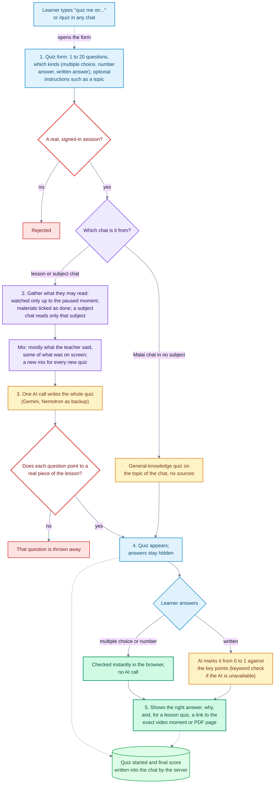

- **Same gates as chat.** The quiz never sees past the playhead, never reads a
  material outside the grant, and a material counts as readable in full only
  when the learner marked it done.
- **Every question is cited.** A question whose `chunk_id` was not among the
  passages sent is dropped, so the source link on each answer is always real.
- **Why the in-order read.** A similarity search for "key concepts, formulas"
  matched mostly on-screen frame descriptions, so quizzes ignored what the
  lecturer said. Reading the watched range in order and balancing speech
  against screen keeps theory questions in the mix.
- **Quizzes from any chat.** The Quiz tab is a form: 1 to 20 questions, the
  question types and optional instructions (a topic, a difficulty). A
  plain-language request in a chat ("quiz me on…") or the `/quiz` slash command
  opens it too. A Malai chat in a subject gets a quiz on that subject's
  materials (`scope_resource_ids`, intersected with the grant); a chat in no
  subject gets a general-knowledge quiz with no citations. The quiz start and
  the final score are written into the chat by the server (`POST /quiz/note`),
  from structured fields rather than client text.

## (e) Lesson page: viewers, cited passages, chats

The lesson page shows the open material beside the tutor. Clicking a citation
shows exactly what it cites.

It is two dockable windows (`components/LessonView.tsx`): the lesson (the
player plus a Chapters / Transcript / Resources panel) and Malai. Malai docks to
any edge by dragging its grip, or with the side-by-side/stacked and swap
buttons on a floating toolbar in the bottom-left corner. The divider resizes,
the panel collapses, and "Hide video" gives Malai the whole space. The layout is
remembered per browser. The Transcript tab is UI only for now.

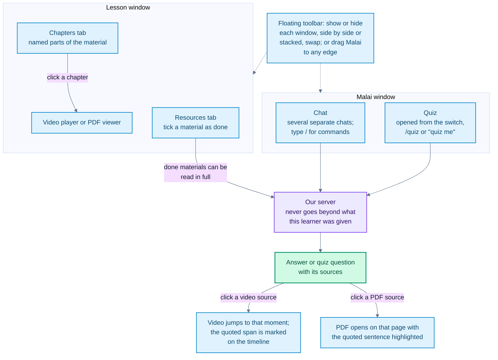

- **Several chats per session.** Each chat (`thread_id`) has its own history;
  the original one is `main`. The chat service itself is unaware of chats: the
  router sets the current chat per request and the message store keys history by
  it.
- **Open material plus what is marked done.** A chat reads the open material up
  to the playhead, plus every material ticked done in the course checklist (read
  in full), and nothing else from the course. The done list is intersected with
  the session grant, so it can never reach a material the session was not given.
- **Cited passages.** Each citation carries the passage text. The PDF viewer
  finds it on the cited page by comparing letters and digits only, so line
  breaks, hyphenation and ligatures do not stop the match (93 of the UNIT-1
  PDF's 97 chunks match in full, the rest partly, none missed).
- **Slash commands.** Every chat (lesson and Malai) has `/explain`,
  `/analogy`, `/summarize`, `/compare` and `/quiz`. Typing `/` opens a menu, and
  each command has its options. They are worded for, and scoped to, what that
  chat can read: a video, a document, a subject, or nothing.

### The rest of the web app

- **Dashboard** (`/dashboard`): a year of study activity (streak, study days,
  time spent), a Malai entry card, continue learning, the next practice quiz
  and the most recent subjects.
- **My subjects** (`/ai-tutor/subjects`): search, Ongoing / Completed /
  Archived filters, sorting and a grid/list toggle. A resource opened from here
  shows without the chat, with an "Open with Malai" button.
- **Malai** (`/malai`): a standalone tutor chat with its own sidebar: each
  subject with its chats, then recent chats in no subject. Chats can be
  searched, renamed, moved into or out of a subject, and deleted; the sidebar
  collapses to a rail. A subject's page (`/malai?s=<id>`) lists its chats and
  resources and starts a chat filed under it. A resource opens beside Malai at
  `/malai/lesson/<subject>/<resource>` in the same dockable layout.
- Activity and progress are recorded in the browser (`lib/activity.ts`) and,
  for a signed-in learner, synced to Supabase (`study_activity`,
  `lesson_progress`, `quiz_attempts`, and the streak from `get_streak()`).
  Archiving stays in the browser.
- **Landing and sign-in.** `/` describes the tutor, with Try demo, Log in and
  Sign up (or Dashboard when signed in). `/login` handles email and password
  and Google. With Supabase configured, the middleware sends signed-out
  visitors from `/dashboard`, `/ai-tutor/*` and `/malai/*` to `/login`; the demo
  lesson stays public.
- **Add content from anywhere.** The subject resources flyout in the Malai
  sidebar and the Malai subject page each have an **Add** button that opens
  the same upload and YouTube ingest dialog as the dashboard. A finished
  ingest refreshes every subject list on the page.
- **Chat names.** A chat's first answer comes back with a short title, written
  in parallel with it, which replaces "New chat" in the sidebar and chat list.
- **Images in a chat.** The image button, drag and drop onto the chat, or a
  pasted screenshot attaches an image. It uploads as soon as it is picked
  (`POST /chat/attachments`) and is read once by Gemini vision (text and math
  copied as LaTeX, figures described). The transcript joins the system prompt
  of every later answer in that chat, marked as the learner's own material, so
  it can never be cited as lesson evidence. Images are never indexed or added to
  a subject.
- **Personalization.** Name, field of study, traits, language, answer length
  and extra instructions, saved in the browser and to the account. They are
  applied to text and voice answers as a style note only.

## (f) Developer view: the live pipeline trace

A floating **Developer view** button (in the top bar on small screens) opens `/dev` in its own window.
It shows, live and animated, each step the server takes for an upload, a
question or a quiz: where the step ran, how long it took, and the data it
carried.

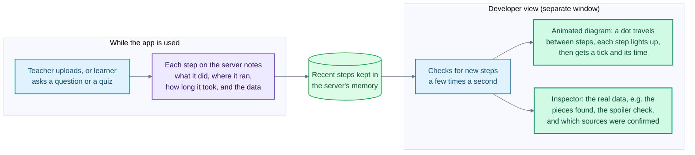

- **What is recorded.** `app/devtrace.py` records one event per step: the
  ingest stages (read, transcribe, describe frames, chunk, embed, store), and
  for a question the session check, the agent-or-classic choice, the query, the
  embedding, the vector search, the strict-T gate (with every passage kept and
  its time range), the model call, citation validation and the reply. Events
  carry ids, times, counts and short text previews, never keys or full prompts.
- **How it gets to the page.** Events sit in a bounded in-memory ring buffer
  (4,000 events) on the API. `GET /dev/trace?after=<seq>` returns the new ones;
  the page polls it every 0.8 s and plays them in order, so a fast answer is
  still readable step by step. **Replay** re-animates any past run.
- **The diagram.** Steps sit in rows by where they run (browser, server, AI
  models, vector database). Lines leave and enter boxes at their sides and are
  routed around every other box. Steps can be dragged within their row, and the
  layout is saved per browser. There are dark and light themes.
- **Recording never changes behaviour.** No trace call can raise into the
  pipeline it observes, and the gate it reports is the same gate that ran
  (`tests/test_devtrace.py`).
- **Limits.** Anyone who can reach the API can read the trace, and a restart
  clears it. `DEV_TRACE=false` turns recording off. See
  [FUTURE_SCOPE.md](FUTURE_SCOPE.md).

## (g) Accounts, saved state and file storage

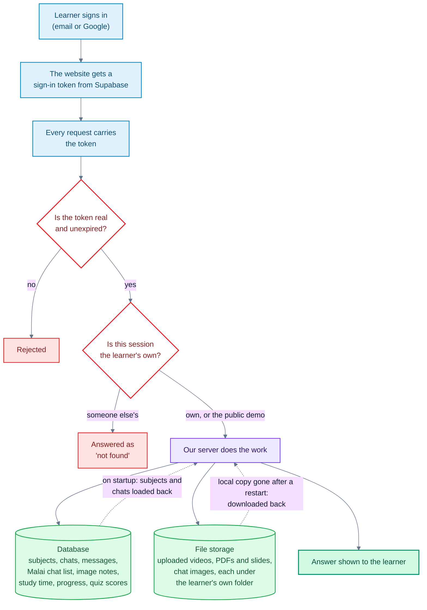

- **Off by default.** Supabase is used only when `SUPABASE_URL` and
  `SUPABASE_SERVICE_ROLE_KEY` are both set (`settings.supabase_enabled()`).
  Otherwise the app runs as before on local files, and a Bearer token is
  ignored.
- **Who you are.** The browser sends `Authorization: Bearer <access_token>`.
  `app/auth/supabase.py` verifies it through the project's JWKS (ES256/RS256)
  or with `SUPABASE_JWT_SECRET` (legacy HS256). `POST /lms/session` then uses
  the user's id as `learner_id` and stores it as the session's `owner_id`, and
  every chat route answers `404` for a session owned by someone else. Sessions
  with no owner (anonymous, the demo) stay open to the HMAC token holder, as
  before.
- **What is saved.** `app/supa/client.py` is a thin httpx client for PostgREST
  and Storage. Subjects and resources, chat sessions, threads and messages,
  the Malai chat list (`malai_chats`) and chat images (`chat_attachments`) are
  written through as they change, and subjects and sessions are loaded back on
  startup. The demo subject is re-added as public if it is missing. Writes are
  best effort: a failed write is logged and the request still succeeds.
- **Files.** Uploads are copied in the background to the private `media`
  bucket at `{owner_id or public}/{resource_id}/{filename}`
  (`app/ingestion/remote_assets.py`), and downloaded back the first time the
  media route needs a file the container no longer has. Deleting a resource
  removes the object and the row. Chat images go to
  `{owner_id or public}/chat/{session_id}/{attachment_id}.{ext}`, and taking
  one back deletes it. YouTube resources have no file, only a row.
- **Row-level security.** Every table has RLS limiting a signed-in user to
  their own rows (`0001_init.sql`, `0002_malai_chats.sql`). The browser uses
  only the public key; the service key stays on the API. `0003_grants.sql`
  grants the table privileges the API roles need. Without it every table call
  fails with `42501`.
- **Malai chat list across devices.** `GET/PUT/DELETE /malai/chats` keep the
  sidebar's chats per user. The browser merges the server list with its own by
  `updated_ms` (at most every 15 s, and on window focus), uploads chats that
  only exist locally, and remembers deletions so they do not come back. The
  list hands back a session token only for sessions the caller owns.

## (h) Voice conversations

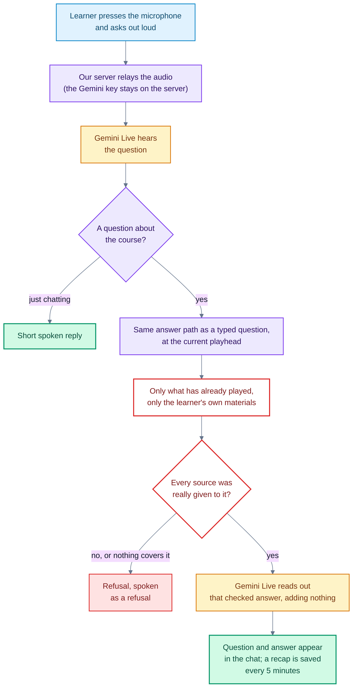

- **Two sockets.** `WS /voice/live` is the conversation and
  `WS /voice/transcribe` is dictation into the input box
  (`gemini-3.5-transcribe-live`). The API opens the Gemini Live session with
  its own key and relays PCM audio both ways (16 kHz up, 24 kHz down), so the
  key never reaches the browser.
- **The voice model never answers course questions itself.** `gemini-3.8-live`
  and the 2.5 native-audio model have one tool, `ask_course(question)`, which
  calls the same `_answer` path as `POST /chat` with the latest playhead (sent
  about once a second), the chat's thread, scope and materials marked done. So
  the strict `end_ms <= T` gate, citation validation and refusals apply. The
  tool returns the answer without citation markers, and the model is told to
  speak it faithfully and add no facts. The extended-thinking model emits no
  tool calls, so for it the server answers each transcribed question itself
  and injects `COURSE ANSWER: …` (or `REFUSED` / `UNAVAILABLE`) for the model
  to read out.
- **Fast and short.** Voice questions use the classic pipeline (no agent),
  with a short answer written for speech.
- **In the chat.** While a session runs, a compact voice bar replaces the input
  box. Each spoken question and its validated answer appear in the chat as
  ordinary messages. A recap of the validated answers (no
  new facts) is saved to the thread every 5 minutes and when the session ends.
- **Same checks as `/chat`.** The first frame must be a `start` within 10 s
  with the HMAC session token, plus the Supabase `access_token` for an owned
  session (browsers cannot set headers on a WebSocket). The rate limit applies,
  the `Origin` must equal `CORS_ORIGIN`, and a session lasts at most 10
  minutes.
- **Voices and language.** The learner picks a prebuilt voice and a speaking
  tone. Hindi or Hinglish speech gets Hinglish replies in Roman script, and
  Devanagari transcripts are romanized for captions and dictation.

## Safety invariants

These are product properties, and the tests pin them. They are not tuning
knobs.

| # | Invariant | Why |
|---|---|---|
| 1 | **Strict timestamp gate: keep a video passage only when `end_ms <= T`.** Never `start_ms <= T`. A missing `end_ms` excludes the passage. The rule is enforced inside the vector query and re-checked in Python. | A passage that *starts* before `T` can still *end* after it, and its tail is a spoiler. The evaluation on our own course measures 0 spoilers in 29 questions. |
| 2 | **Citations are validated against the retrieved set.** Uncited answers and unknown ids are refused. | A model can cite a plausible-looking id that was never retrieved. Passing that through presents an ungrounded answer as grounded. |
| 3 | **Scope is intersected, never replaced.** The focused video narrows the granted `resource_scope`; it cannot widen it. Materials marked done are intersected with the grant the same way, and a quiz question citing anything outside the passages sent is dropped. | An earlier version replaced the scope with the focused id, which let a client read outside its grant. |
| 4 | **Plausible-looking ids are not real ids.** Subjects refuse to attach a resource id that the index cannot vouch for. | A scope such as `["res_video"]` once matched no indexed chunk and silently refused every question. |
| 5 | **Timestamps come from signals, not from the model.** ASR segment times and frame-index arithmetic set the times; a live frame sits at exactly `T`. | A model that labels a frame from 650 s as "index 5" would otherwise store it at 20 s, which is a spoiler leak. |
| 6 | **Signed launches in production.** `LMS_LAUNCH_SECRET=dev-secret` with `ALLOW_UNSIGNED_LAUNCH=true` is for a localhost demo only. Hosted, the Vercel server route signs launches and the API runs with `ALLOW_UNSIGNED_LAUNCH=false`. | The launch carries the learner, the course and the allowed resources. Unsigned, anyone could grant themselves any scope. |
| 7 | **Secrets stay out of the repo and the browser.** `apps/api/.env` is git-ignored. The web app's launch secret is server-only (no `NEXT_PUBLIC_` prefix). | |
| 8 | **Model HTML stays inert.** No `rehype-raw`, and KaTeX runs with `trust: false`. `npm run contract-check` fails if either is broken. | Answers are model output rendered in the learner's browser. |
| 9 | **Learner images are context, not evidence.** A chat image's transcript has no chunk id, is marked as the learner's own material in the prompt, and is never indexed or attached to a subject. | Otherwise a learner could upload "lecture notes" that the tutor would cite as the course. |
| 10 | **Voice speaks only validated answers.** Course questions asked by voice go through the same gate and citation check as typed ones; the voice model only reads the result. | A voice model answering from its own knowledge would bypass every check above. |
| 11 | **A session belongs to its owner.** A signed-in learner's session answers `404` to anyone else, even with a valid HMAC token, and the Supabase service key never leaves the API. | Session ids appear in URLs and the chat list; the token alone should not be enough to read another learner's chats. |
